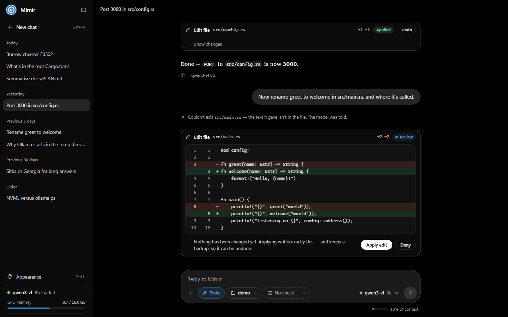
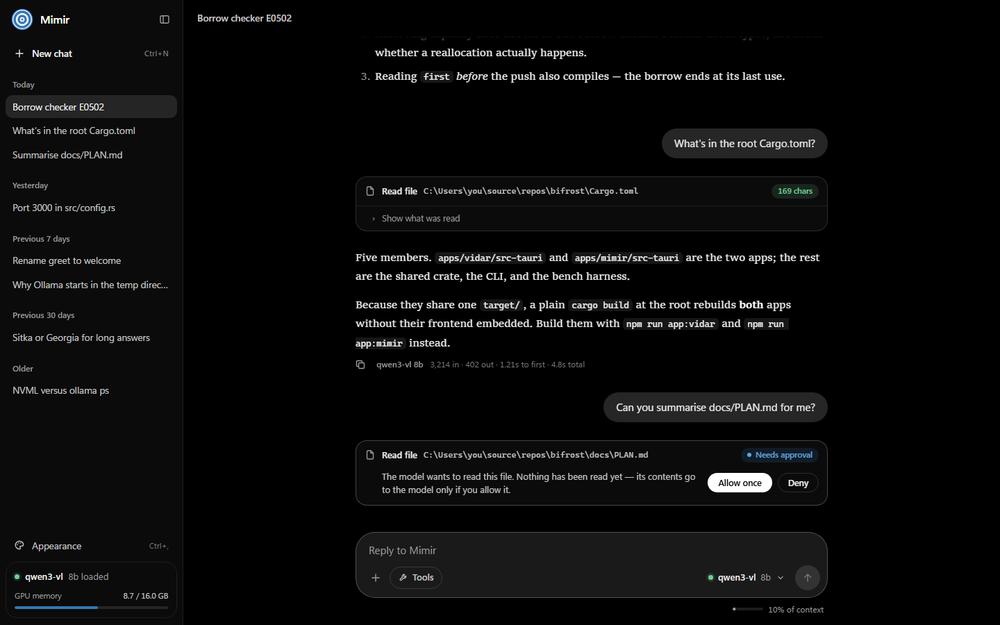
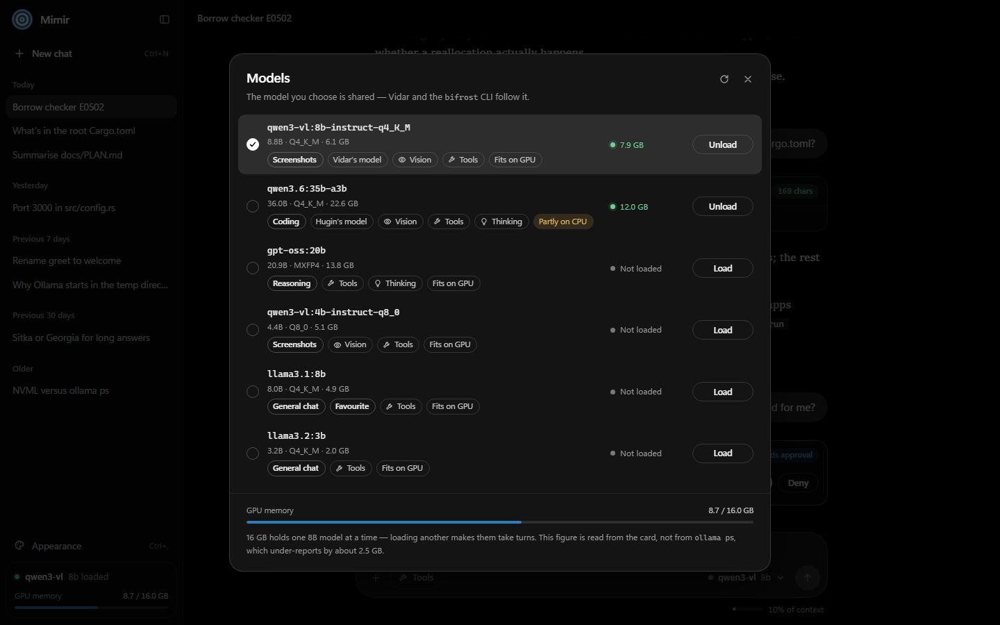
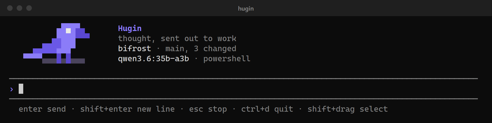
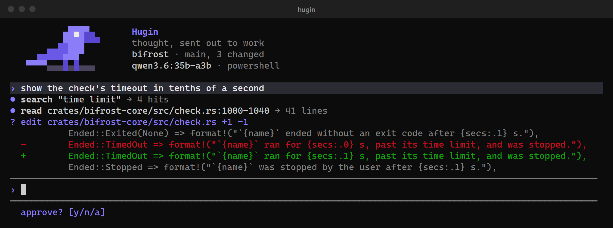
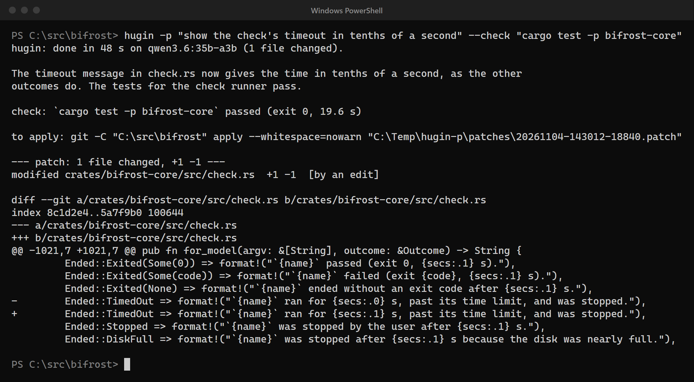
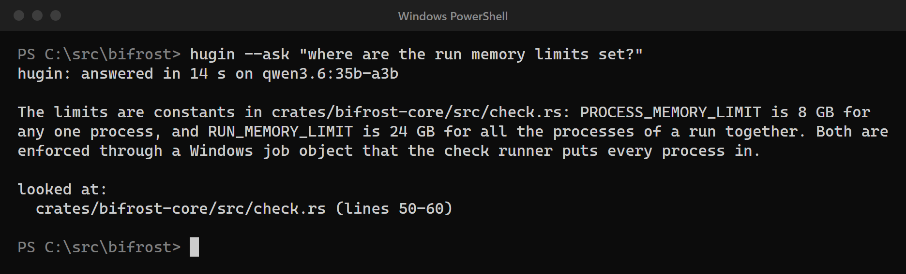
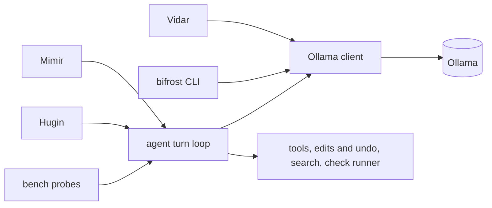

# Bifrost

Local-first AI tools for Windows 11: a screen assistant, a code-aware chat app and a terminal coding agent, all running on one local model.

[](https://github.com/LuisZarate17/bifrost/actions/workflows/ci.yml)


[](LICENSE)



## What's in it

| | |
|---|---|
| **Vidar** | A tray app: press `Ctrl+Alt+W`, a local vision model looks at a screenshot, and the answer streams into a small popup in the corner. It also carries the Bifrost tray menu (model switch and picker, shortcuts to the other apps). |
| **Mimir** | A desktop chat app: in a project folder you choose, it finds code, reads and edits files (each change approved by you first), runs the folder's check, and can undo what it did. |
| **Hugin** | A coding agent for the terminal. `hugin -p "task"` works unattended in a scratch copy of the repo and returns a patch and a report; `hugin --ask "question"` answers code questions and lists the files it read. |
| **`bifrost`** | The command line: Vidar's screenshot pipeline without the popup, plus `warm`, `off` and `status` to load and unload the model. |

|  |  |
|---|---|
|  |  |

## Highlights

- **Fully local.** Everything runs on one model served by Ollama. The one opt-in exception is Mimir's "Check with Claude" button: off by default, only on a click, and it shows exactly what it would send first.
- **Per-call approval, exact and undoable edits.** An edit is rendered to its final bytes and shown as a diff before anything is written. Applying it writes those bytes only, and undo restores the file byte for byte.
- **Unattended coding in a scratch copy.** `hugin -p` never touches your folder: it works in a throwaway copy and hands back a patch and the check's result.
- **Guards against faked passes and edited tests.** A "done" that follows a failing check is pushed back, patches that remove lines from existing tests are flagged for review, and a check that could not give a verdict is never reported as a pass.
- **Resource limits on model-written code.** Every run is placed in a Windows job object: 8 GB per process, 24 GB per run, a free-disk floor, a timeout and offline builds.
- **Model choice backed by hidden-test benchmarks.** The coding model was picked by running candidates on real tasks from this repo, scored by tests the model never sees. See [how it was built](docs/HOW-IT-WAS-BUILT.md).

A look at Hugin. These are drawn by Hugin's own rendering code from a scripted session (`npm run shots:hugin`), so no model ran for them, except that the `--ask` answer is a real one from `qwen3.6:35b-a3b`, and its file list is built from the reads that actually ran.

|  |  |
|---|---|
|  |  |
|  |  |

## Getting started

You need Windows 11, [Rust](https://rustup.rs) stable with the MSVC toolchain, Node.js 20.19 or newer (22 LTS is fine) and [Ollama](https://ollama.com). Then pull the models:

```
ollama pull qwen3-vl:8b-instruct-q4_K_M   # Vidar and the CLI: a vision model
ollama pull qwen3.6:35b-a3b               # Hugin and Mimir's coding model (the benchmark winner)
```

Both are set in `%APPDATA%\bifrost\config.json`, the one file every app shares. The coding model is large (about 22 GB); on the development machine's 16 GB GPU, the part that does not fit runs on the CPU.

```
git clone https://github.com/LuisZarate17/bifrost.git
cd bifrost
npm install
npm run app:vidar        # builds Vidar to target/debug/vidar.exe
npm run app:mimir        # builds Mimir to target/debug/mimir.exe
cargo build -p hugin     # Hugin is a plain console app, so cargo is right for it
node tools/shortcuts.mjs # Desktop and Start Menu shortcuts; puts hugin on your PATH
hugin                    # in any terminal, in the folder you are in
```

> **Tip:** build the two Tauri apps with `npm run app:*`, not `cargo build`. Plain cargo leaves the dev-server URL baked into the binary, so the window shows a "can't reach this page" error unless a dev server happens to be running. `npm run app:*` embeds the frontend, so the app opens on its own. A bare `cargo build` at the repository root skips both apps for that reason.

Every Vidar control is listed in [docs/shortcuts.md](docs/shortcuts.md).

## Architecture

Everything that matters lives in one Rust crate, `crates/bifrost-core`: the Ollama client, tools and edits with undo, search, the check runner, scratch copies, context compaction and the shared config. The apps are thin frontends that show things and ask questions; the engine decides what is allowed. Mimir and Hugin drive the same agent turn loop behind a small `Frontend` interface, so the benchmark probes measure the code that ships.



More in [docs/HOW-IT-WAS-BUILT.md](docs/HOW-IT-WAS-BUILT.md).

## How it's evaluated

- CI runs fmt, clippy and the full unit suite on Windows on every push; model-dependent and memory-heavy tests are excluded with `#[ignore]`.
- Over 1,100 Rust unit tests, plus ten Node scripts that drive the real Mimir app and assert on what is on screen and on disk.
- Benchmark probes in `crates/bench` measure the model, not the code: can it emit a well-formed tool call, can it solve function-level tasks, can it solve ten real tasks in this repo given through `hugin -p`, and can it answer questions about the code correctly. All are scored by hidden tests or fact checks, and were frozen before any candidate was run.
- Result: on the real tasks `qwen3.6:35b-a3b` passed 76% of the runs it completed against 43% for the `qwen3-coder:30b` baseline, and decoded about 1.5 times faster. The run was stopped early and the write-up says what that leaves unproven.

Details and the full tables are in [docs/HOW-IT-WAS-BUILT.md](docs/HOW-IT-WAS-BUILT.md).

## Repository layout

```
apps/       vidar/ (tray app), mimir/ (chat app), hugin/ (terminal agent)
crates/     bifrost-core/ (shared engine), bifrost-cli/ (the bifrost command), bench/ (benchmark probes)
packages/   ui/ (the Markdown renderer both GUI apps share)
evals/      benchmark tasks, fixtures and saved runs
tools/      shortcuts, screenshots, end-to-end scripts that drive Mimir
docs/       shortcuts.md, HOW-IT-WAS-BUILT.md, and archive/ (the raw development log)
```

## License

[MIT](LICENSE)
