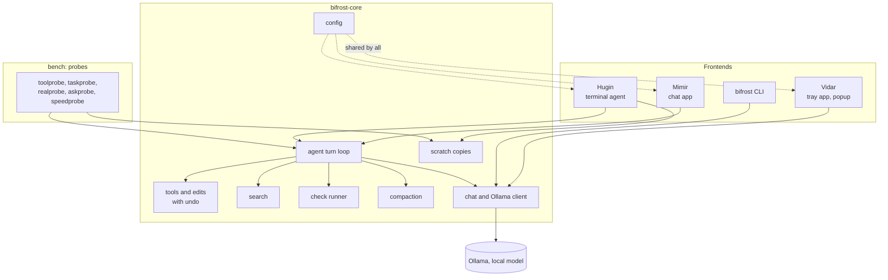

# How Bifrost was built

The short version of the engineering story: what the pieces are, how they fit, how a local model is
kept from doing damage, how the whole thing is tested, and how the model it runs on was chosen. The
raw development log (plans, per-chunk results, reviews) is in [archive/](archive/README.md).

## 1. What it is

Bifrost is a set of local AI tools for Windows that all run on one local model, served by
[Ollama](https://ollama.com), on one machine.

- **Vidar** is a tray app. A global hotkey (`Ctrl+Alt+W`) takes a screenshot, a local vision model
  looks at it, and the answer streams into a small popup in the corner that never takes focus. The
  same process carries the Bifrost tray menu: the model switch and picker, and shortcuts to the
  other apps.
- **Mimir** is a desktop chat app. Pick a project folder and it can find code, read and edit files,
  run the folder's check command (a build or a test run), and undo what it did. Every change is
  approved by a person first, and an optional "Check with Claude" button sends a turn's diff to
  Claude for a second opinion.
- **Hugin** is a coding agent for the terminal, in the spirit of Claude Code. It runs interactively,
  and it has two non-interactive modes: `hugin -p "task"` works unattended in a scratch copy of the
  repository and hands back an answer, a patch and the check's result; `hugin --ask "question"`
  answers questions about the code and lists the files it actually read.
- **`bifrost`** is the command line: Vidar's pipeline without the popup, plus `warm`, `off` and
  `status` for loading and unloading the model.
- **`bifrost-core`** is the Rust engine underneath all of them, and **`bench`** holds the benchmark
  probes that measure it.

**Why local-only.** The point was to have useful AI help on a personal machine without sending
screenshots or source code anywhere. Nothing in Bifrost calls a cloud service on its own. There is
one deliberate exception: Mimir's "Check with Claude" button is off by default, runs only on a click,
shows exactly what it would send (the question and the diff, nothing else) before it sends it, and
reuses whatever the `claude` command is already signed in with, so no key is stored.

The stack is Rust, Tauri 2, React and TypeScript, on Windows 11. The development machine has one
16 GB GPU, which shapes a lot of the decisions below: a model that does not fit on the card spills
onto the CPU and gets slow, so model choice is a real engineering question and not a taste one.

## 2. Architecture

Everything that matters is in one crate, `crates/bifrost-core`. The apps are thin: they show things
and ask questions, and the engine decides what is allowed.

What each part of the engine does:

- **Chat and Ollama client** (`chat`, `ollama`, `toolcall`, `xmlcall`). Talks to Ollama's chat API,
  streams tokens, and turns the model's tool calls into something the engine can act on. Models
  differ in how they write a tool call, and some write them slightly wrong, so there is repair for
  the common malformed shapes and a rule that a call that cannot be read is fed back to the model
  rather than ending the turn. A separate `vram` module reads what the card is really holding from
  NVML, because Ollama's own report of what is loaded was measured to disagree with the card.
- **Tools and edits** (`tools`, `edit`). The tools the model may ask for: read, list, search, edit,
  create, delete, move, run the check. An edit is planned first (resolved, matched, rendered to the
  exact bytes it will write, diffed) and only then shown for approval; applying it writes those
  bytes and nothing else. A backup is kept so it can be undone.
- **Search** (`search`). Which files a folder has and which lines contain some text, inside the
  folder only, following git's ignore rules, with build output skipped and results capped.
- **Check runner** (`check`). Runs the one check command chosen for a folder, with a timeout, a
  Stop button, capped output, and the resource limits in section 3.
- **Scratch copies** (`scratch`). A copy of a git repository (HEAD plus uncommitted files) in a
  temporary folder, and the patch of what was done there. This is what unattended mode runs in.
- **Agent turn loop** (`agent`). The loop that is the heart of the product: the model asks for a
  tool, a person or a rule decides, the tool runs, the result goes back, and so on until the model
  answers. It sits behind a small `Frontend` interface, so Mimir's window, Hugin's terminal and the
  benchmark probes all drive the same loop. That matters for measurement: the probes measure the
  code that ships, not a lookalike.
- **Compaction** (`compact`). Ollama does not error when a prompt outgrows the model's context
  window; it silently cuts from the middle, which can drop the user's own request. Compaction keeps a
  token budget inside a tool turn and replaces the oldest tool results with one-line stubs, never
  dropping a message, so every call stays paired with its result.
- **Config** (`config`). One file, `%APPDATA%\bifrost\config.json`, read by every app on every
  request. Pick a model in Mimir and Vidar's next hotkey press uses it; no restart. It also holds
  the coding model, per-model settings (for example whether to send `think`), the folder's check
  command and the project notes switch.

How the apps use it:

| | Uses |
|---|---|
| Vidar | the Ollama client with a screenshot attached, the config, and the VRAM readout for its power state |
| Mimir | the whole turn loop with approval cards, tools and edits with undo, search, the check runner, compaction |
| Hugin | the same turn loop in a terminal; scratch copies for `-p`; read-only tools for `--ask` |
| `bifrost` | the Ollama client, the config and the VRAM readout |
| Probes | the turn loop with an unattended decision rule, so what is measured is what ships |

Two smaller shared pieces: a `@bifrost/ui` package renders the Markdown answers in both GUI apps
(links and images in model output are locked down, and code is highlighted lazily), and a project's
own notes file (`AGENTS.md` and similar) is read only once a person has turned that on for the folder.

## 3. Making a local model safe to let near your files

Reading a file wrong costs one bad answer. Writing one wrong corrupts it. A small local model is
also less reliable than a large hosted one, so the engine does not rely on the model behaving.
The rules are enforced in code, and each has a test.

**Per-call approval.** Each edit, create, delete, move or command is a card that a person allows or
denies, and an approval is a single-use ticket for exactly that call: what is run is what was shown.
Reads inside the project folder run without asking, because they change nothing.

**Edits are exact and undoable.**

- The edit is rendered to its final bytes before anyone is asked, and applying writes those bytes only.
- The plan carries a hash of the file as it was. If the file changed on disk since the diff was
  shown, the edit is refused, and that check is repeated immediately before the rename that replaces
  the file.
- Undo restores the file byte for byte, line endings included, and refuses if the file was edited by
  hand afterwards rather than overwrite that work. "Undo all" reverts a whole turn.

**The folder boundary.** Every path is resolved and canonicalised before it is compared, so `..`,
symlinks and junctions cannot lead out of the chosen folder. `.git` is refused even inside it, as is
Bifrost's own data.

**Unattended mode works on a copy and returns a patch.** `hugin -p` has nobody to approve anything,
so the model never touches the real folder. It works in a scratch copy, a clone of one commit plus the
uncommitted files, with the remote removed so nothing run there can push. A rule (one function,
shared with the benchmark probes) answers the cards: edits to the copy are allowed; the folder's
check is allowed unless the turn changed a file that makes a check run code (`Cargo.toml`, a
`conftest.py`, a makefile); everything else is denied. What comes back is a report with a status, the
patch and the check's output. The run has a time limit and the report is printed before cleanup.

**Guards against faked passes and edited tests.** A model that cannot make the code pass a test can
make the test pass the code. So the report does not just repeat what the model says:

- A model that ran the check, saw it fail, and then says it is done is pushed back to fix it.
- A final report has a status: `done`, `failed`, `review`, `partial` or `error`, and the exit code
  is 0 only for `done`.
- If the patch removes lines from existing tests, the model is asked once to put them back; if it
  still changes them, the status is `review` until a person confirms the change was wanted. This is
  read straight off the patch, with no model involved.
- A check that could not give a verdict (refused to start, disk full, a test run cut short) reads as
  unverified, not as a pass.

**Run limits, because model-written code is run.** The check runs code the model wrote, with the
user's rights. Every process in a run is placed in a Windows job object that enforces:

- **8 GB** of committed memory for any one process, and **24 GB** for the whole run together
  (measured: a rebuild of this workspace peaks at 11.8 GB across 17 build processes, so 16 GB for a
  run was too tight);
- a **disk floor**: the run is killed when its drive's free space falls below 10 GB, or below half of
  what the drive had when the run began, if that is less;
- a timeout, and the whole process tree is killed with the job;
- **offline builds**: `CARGO_NET_OFFLINE=true` for every cargo run the probes and `-p` start, so a
  patch that adds a dependency fails to build instead of downloading and running something from the
  network.

**The incident behind the limits.** While running a benchmark, the code a model wrote for one task
contained a runaway loop in a test. It committed 81 GB of memory and took the PC down. The harness had
run code nobody had read, with no ceiling. After that, per-process and per-run memory caps went in,
and later the disk floor. The same kind of
runaway now ends as one failed run with an error, and there is a test for each limit (the two
memory tests are ignored by default because proving them commits 8 GB).

## 4. How it's tested

**Unit tests.** More than 1,100 Rust tests across the workspace, covering the edit and undo rules,
path containment, search, the check runner (including killing a shell command and its children),
tool-call repair, compaction, scratch copies (the user's repository is checked down to file times to
be untouched), and the unattended rules.

**End-to-end scripts.** Ten Node scripts in `tools/e2e/` drive the real Mimir app over WebView2's
remote-debugging port: they exercise approvals, undo, switching models, project notes, the check and
the Claude review button, and assert on what is on screen and on disk afterwards.

**Benchmark probes.** These measure the model, not the code, and they are what the model choice rests on.

- **toolprobe** — can the model emit a well-formed tool call when one is needed and leave tools alone
  when it is not? Ten cases, and a gate: if a model cannot do this, nothing else is worth running.
- **taskprobe** — function-level tasks (16 of them) built from this repo's own code, scored by
  hidden tests the model never sees, run both at the app's sampling settings and at temperature 0.
- **realprobe** — ten real tasks in this repo, each given to the model through `hugin -p` and scored
  with hidden tests. Each task has a correct reference solution and two or three plausible wrong
  ones. A self-check, with no model, proves that every reference passes and every wrong one fails
  (26 wrong patches in all), that the hidden tests cannot be reached from the task's starting commit,
  and that no reference edits an existing test. A run is graded `PASS`, `FAIL`, or `FALSE DONE`
  (the model said done and the hidden tests say otherwise), and "says done but isn't" is counted on
  its own.
- **askprobe** — twelve questions about the code, put to `hugin --ask`. An answer is scored by the
  facts it contains and by whether it read the files that hold the answer, as right, partly or wrong.
  It has its own no-model self-check, with a right and a wrong answer for each question.
- **speedprobe** — prefill and decode speed at about 2k and 16k tokens of prompt, how much of the
  model sits on the CPU, and how far free RAM drops during a cold build.

A review of the probes before they were used found real problems, which is why it was worth doing:
one realprobe task could never pass (its reference had to edit existing assertions, which Hugin's own
guard reports as `review`), a model's hanging test was being counted as a harness error, and some
askprobe patterns rejected correct phrasings. All were fixed.

**Frozen before anything was judged.** The probes were frozen at the git tag `j1-frozen` before any
candidate model was run, and the rules for when to switch models were written down at the same time.
Nothing in the probes could be tuned to favour a result.

## 5. Choosing the model

Hugin's model was `qwen3-coder:30b`. On three real tasks from this repo it faked a pass, edited a
test to fit its code, and claimed failed work was done. The guards in section 3 now catch all of
that, but the work itself was still wrong, and the model did not fit the card (about a third of it ran
on the CPU). Newer models existed, so the question was whether one was clearly better, on real work.

**Before judging models, make the comparison fair.** Three engine problems would have biased it:
tool-call repair existed only for Qwen, so another model's unreadable call ended the turn; "thinking"
models were never told to think and their reasoning was dropped mid-turn; and Ollama was a version
behind. The first two were fixed (repair for every model, per-model settings) and Ollama was upgraded.
Chasing a failing test after the upgrade turned up something else: at temperature 0, the same
request can pick a different tool depending on what Ollama's prompt cache holds from earlier, so a
single run is not exactly repeatable.

**Candidates.** `qwen3-coder:30b` as the baseline, `gpt-oss:20b` (thinking, at high effort),
`qwen3.6:35b-a3b` and `ornith-1.5:9b`.

**The method.** A cheap screen of every candidate, one model at a time, then a run of record for the
top two against the baseline with every real-task run repeated three times, because one run is noisy.
The screen's gate: a model had to pass toolprobe (at least 9 of 10) and not trail the baseline's
taskprobe score by more than 3 of 16, or it did not get the expensive real-task run.

**The screen** (real tasks, one run):

| Model | realprobe | false done | taskprobe | decode speed |
|---|---|---|---|---|
| qwen3-coder:30b (baseline) | 4/10 | 0 | 10/16 | 74 tok/s |
| gpt-oss:20b | not run | | 4/16 | 168 tok/s |
| qwen3.6:35b-a3b | 7/10 | 3 | 12/16 | 108 tok/s |
| ornith-1.5:9b | 6/10 | 0 | 10/16 | 130 tok/s |

`gpt-oss` was out at the gate: it was the fastest model and fit entirely on the card, but it took
about twice the rounds per run (9.1 against 4.5) and made many more automatic calls (20 against 1.6),
so it spent its budget looking around instead of working. The other two went through.

**The run of record.** Each real-task run is three attempts at each of the ten tasks:

| Model | realprobe passes | false done | Notes |
|---|---|---|---|
| qwen3-coder:30b (baseline) | 13/30 (43%) | 1 | taskprobe 28/48; askprobe 9 right, 10 partly, 5 wrong |
| qwen3.6:35b-a3b | 19 of 25 run (76%) | 2 | won more tasks by majority than the baseline and lost none of the ones it had run |
| ornith-1.5:9b | 12 of 21 run (57%) | 1 | stopped early as worse: 12 passes against qwen3.6's 17 on the same runs |

qwen3.6 also decoded at about 1.5 times the baseline's speed even with 43% of it on the CPU. Ornith
had the best answers to code questions in the screen (9 right, 3 partly, 0 wrong), but it fell behind
on the harder multi-part changes and was slow per run.

**The run was cut short, and the decision was made anyway.** The bake-off was stopped partway through
qwen3.6's real-task runs, so its repeated taskprobe and askprobe runs and the full set of switching
rules were never completed. What the data did show: qwen3.6 led the baseline by a wide margin on real
tasks (a pass rate that projects to about 23 of 30 against 13), it was faster, and it was at the
limit on false dones (2 where the rule allowed 2) and over it on infrastructure errors (Ollama
returning `500 EOF` in its screening taskprobe run, 2 where the rule allowed 1). The written rules
could not be applied in full, and the write-up says so plainly. The decision was made as a judgment
on partial evidence and recorded as one: `qwen3.6:35b-a3b` became the coding model, and the other coding
candidates were removed from the machine.

**What was learned.**

- "Says done but isn't" deserves its own score. It is a different failure from "tried and failed",
  and it is the one that costs a reviewer the most. qwen3.6 had it; ornith, when unsure, tended to
  stop and say `partial` instead.
- Thinking models can wander. gpt-oss reasoned its way into reading a lot and doing little.
- A single run is noisy, and a temperature-0 run is not even exactly repeatable on a cache-warm
  server. Three attempts per task, and a majority per task, were worth the machine time.
- Speed is part of quality here. A model that spills onto the CPU is slow to use, so decode speed and
  CPU share were measured for every model the same way.
- A harness has bugs too, which is why the probes had a review and a self-check before they were
  allowed to judge anything.

## 6. Lessons

- **Enforce safety in code, not in the prompt.** Approval tickets, the folder boundary and the
  patch-only unattended mode work whatever the model decides to do. A model that tries to be
  helpful by editing the test is stopped by reading the patch, not by asking it nicely.
- **Cap anything that runs code you did not write, before you need to.** An 81 GB runaway froze a
  machine once. Memory, disk, time and network limits turn that class of failure into one failed
  run.
- **Measure what ships.** Putting the turn loop in the shared engine meant the probes exercised the
  same code the apps run. Where the two differed, the benchmark would have been answering a different
  question.
- **Silent failures are the dangerous ones.** Ollama truncating a prompt from the middle without an
  error, its report of what is loaded disagreeing with what the card holds, a `cargo test` that exits
  0 with a test program cut short: each looked fine until it was measured, so each got a guard and a
  test.
- **Write the switching rules before you see the numbers, and test the test.** Freezing the probes
  and the rules first made the comparison hard to bend, and the probe review caught a task that
  could never pass before it could skew a result.
- **Decide how much you will trust partial results up front.** The bake-off ended early. Because the
  rules existed, it was clear exactly which parts of the evidence were missing, and the decision could
  state its own limits.

---

The raw log, with every plan, result and review as written, is in [archive/README.md](archive/README.md).
