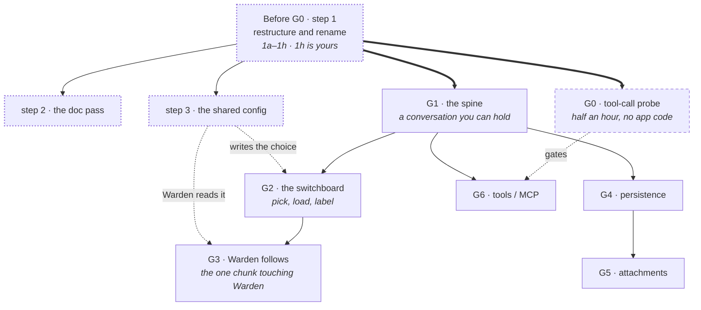

# Stage G — Execution Packet

**Paste this into a fresh chat.** Self-contained; it doesn't assume the earlier conversations.

---

## Context

I'm building a **local chat desktop app** — Claude Desktop's shape, but every token stays on this
machine. Conversations, history, attachments, and eventually tool calling.

It is a **new app in an existing workspace**, not a feature bolted onto the one already there.

The existing app is **Warden**: a summoned overlay that screenshots the screen on a hotkey and
(Stage C complete; `BUILD.md` says "nothing to build"). **Only G3 changes Warden**, and only to make
it follow the model this app chooses.

**Why a separate app, not a second window.** PLAN.md §0 makes Warden *"summoned, never ambient."*
A chat app is the exact opposite — windowed, persistent, focused, left open. One binary cannot
hold both rules without one of them losing. They share a backend instead, which costs nothing:
Ollama is already a server anything on this machine can reach, and `warden-core` exists precisely
*"now that there are two callers."* This is the third caller.

**About me:** Warden was my first Rust. Explain what you're doing rather than just handing me
code — I want to actually learn this.

**Hard rule:** everything runs locally. No cloud API calls, ever, for any reason. If a local model
is bad at something, the answer is a different local model, not a fallback.

---

## Machine (verified at Stage B — don't re-derive)

- RTX 5070 Ti, **16 GB VRAM**, Blackwell (sm_120)
- Ryzen 7 9700X, 31 GB RAM
- **One monitor, 1920×1080, 100% scaling**
- Windows 11 Pro build 26200
- Rust 1.98.1 MSVC · Node 24.18 · WebView2 Runtime installed
- Ollama 0.33.3 · `qwen3-vl:8b-instruct-q4_K_M` *(reports `completion` + `vision` + `tools`)*
- Repo root: `C:\Users\you\source\repos\warden`

**Match Warden's versions — Citadel is a sibling, not a newer thing.** Tauri 2 (`tray-icon`,
`image-png`), `@tauri-apps/api` ^2, React ^19.1, TypeScript ~6.0.3, Vite ^8.0.16.

---

## Citadel is an ordinary window — most of Warden's tricks do NOT apply

You will read Warden's `lib.rs` for patterns, and it is full of Win32 work that exists only because
the popup is a click-through overlay that never takes focus. **Copying any of it into Citadel would
be a bug.** Citadel is a normal, focusable, resizable application window.

| Warden does | Citadel should |
|---|---|
| `focusable: false`, `SW_SHOWNOACTIVATE` | Take focus normally — you are typing in it |
| `WS_EX_TRANSPARENT` click-through | Receive the mouse like any window |
| `decorations: false`, `skipTaskbar: true`, `alwaysOnTop` | Have chrome, sit in the taskbar, no always-on-top |
| A low-level global mouse hook for the wheel | Just scroll. It owns its own wheel events |
| A tray icon | **No tray icon** — see decision #5 |
| Global shortcuts bound and released per show | None. A windowed app does not claim global chords |

What *does* carry over: the `Channel` streaming pattern, `spawn_blocking` around every `odin-core`
call, the Markdown renderer, and the log-to-file trick if you make it windowless (you probably
should not — a console is useful while building).

> **Scaffolding warning, carried from STAGE-B and worth repeating.** **Never run
> `create-tauri-app` at the repo root.** Passing `.` and accepting the overwrite prompt
> **recursively deletes everything except `.git`** — verified in its source. `evals/shots/` is
> gitignored and would not come back. Scaffold into a sibling temp directory and move files in by
> hand, or hand-write Citadel's `src-tauri/` against Warden's as the reference.

---

## What already exists

```
warden/
├── warden-core/      SHARED — ollama (ps/find/load/unload/is_running/ensure_running), vram (NVML)
├── capture/          the CLI: screen → PNG → Ollama → streamed answer, plus warm/off/status
├── src-tauri/        Warden, the overlay app — hotkey, popup, tray, power control
├── src/              Warden's React frontend — App.tsx, Answer.tsx, CodeBlock.tsx
├── bench/            F1 harness: model × image × prompt → TTFT, decode rate, resident VRAM
├── evals/            cases.md rubric, fixtures/, saved runs
├── tools/icon/       generates Warden's icon set — it does NOT touch shortcuts (see 1g)
├── stages/           STAGE-A, STAGE-B, and this file
├── docs/             see docs/README.md — it is a navigator for the whole repo
│   ├── PLAN.md  BUILD.md  shortcuts.md  D-testing.md  PENDING-CHECKS.md
│   └── results/      A1–A4, B1–B4, C1b, C2, C4a, F1 write-ups
└── index.html  package.json  vite.config.ts  tsconfig.json  public/
                      ^ Warden's, at the root — this is the collision Before G0 fixes
```

**Read [`docs/README.md`](../docs/README.md) first.** It maps every document and, more usefully,
every function: which file registers the hotkey, where the capture pipeline lives, where the
clipboard write happens. It will save you grepping.

> **This is the layout as it stands, and the names this document uses throughout.** "Before G0"
> step 1 restructures it: `warden-core` becomes `odin-core`, `capture/` becomes
> `crates/odin-cli/`, and Warden moves into `apps/warden/`. Every mention of `warden-core` below
> means `odin-core` once that step is done — the old names are kept here so the instructions match
> what you will actually be looking at when you start.

### What you reuse, and what you write fresh

| Reuse as-is | Where |
|---|---|
| Streaming Markdown renderer with mid-stream fence repair | `src/Answer.tsx` + `remend` |
| Shiki highlighting — lazy, JS regex engine, no WASM | `src/CodeBlock.tsx` |
| XSS/exfil hardening, verified by assertion | `npm run check:inert` |
| Power control measured against **NVML**, not `ollama ps` | `warden-core::vram` |
| Ollama autostart, ps/find/load/unload | `warden-core::ollama` |
| Token streaming Rust → React over `tauri::ipc::Channel` | B2's pattern in `src-tauri/src/lib.rs` |
| Model benchmarking | `bench/` |

| Write fresh | Why |
|---|---|
| **`/api/chat` client** | `warden-core` only speaks `/api/generate` — no roles, no messages array, and it **cannot carry tools at all** |
| Conversation storage | Warden deliberately saves nothing |
| Window chrome, conversation list, composer | Warden has no chrome — it's a click-through overlay |

---

## Five decisions already made — do not relitigate them mid-build

These are cheap now and a rewrite later. That is the only reason they are settled up front.

1. **`/api/chat`, never `/api/generate`.** Messages-with-roles is the substrate for everything
   above it: an attachment is a field on a message, a tool call is a field on a message.
   `/api/generate` has nowhere to put either.

2. **The stored message record carries fields it does not use yet** — `images`, `tool_calls`,
   `model`, `created_at`. A record of `{role, content}` forces a migration of a database already
   holding real conversations the moment G5 lands.

3. **One shared config, at `%APPDATA%\odin\config.json`.** It holds the current model tag and the
   prompt, it is read through `odin-core`, and **a missing file is a normal state that yields the
   built-in defaults.** The prompt currently exists in three places
   (`warden-core::DEFAULT_PROMPT`, `capture/prompt.txt`, and a `const` in `src/App.tsx` whose own
   comment assigns the job to a chunk that was dissolved). Do not add a fourth — Before G0 step 3
   reduces it to one.

4. **One current model, and this app owns it.** Not per-app overrides — a single resident model
   that both apps use. This app is the switchboard: it loads, unloads, tests and picks. Warden
   reads that choice and follows it.

   **This is the shape the hardware already forces.** 16 GB will not hold two 8B models, so
   "per-app model" was never real — it was two apps evicting each other's runner. One resident
   model, chosen in one place, is the honest version.

   **And it is affordable, because capability is queryable** — see the `/api/show` finding below.
   `qwen3-vl:8b-instruct-q4_K_M` reports `["completion", "vision", "tools"]`, so a single resident
   model can serve the chat window, Warden's screenshots, and tool calling at once.

5. **Two shortcuts, two apps, and Warden never depends on this one.**

   Warden already has Desktop and Start Menu shortcuts, and launching it is already the whole
   "quick access" story: the hotkey goes live, the tray appears, and there is no window to open.
   This app gets its own shortcut beside it. **Launching one must never launch the other**, and
   either alone must be fully usable.

   **The trap this closes.** G3 makes Warden read a shared config. If that config only exists once
   *this* app has written one, then Warden on a fresh machine has nothing to read — and a new app
   would have broken the finished one. So: a missing config is a **normal state, not an error**,
   and the read falls back to Warden's own built-in default.

   **Only Warden gets a tray icon.** It has no window, so the tray is its only surface. This app
   has a window and belongs in the taskbar. Two tray icons for one project is a wart, and the
   split is clean — no window means tray, a window means taskbar.

   **Give them different marks.** `tools/icon/` generates Warden's icon; this app needs a variant
   from the same family, not the same image. Two identical icons on the Desktop is worse than no
   icon at all.

   **Not this app's job:** starting, stopping, or reporting on Warden. It is tempting to add a
   "hotkey is live" indicator, and it is coupling for a fact you can read off the tray.

---

## Hard-won facts that carry into Stage G

**The Ollama contract** (measured across 40+ requests at A2, re-confirmed at A4 and F1):
- Raw base64 for images, **no `data:` prefix**.
- **`num_ctx` must be set explicitly**, inside `options`. Ollama derives its default from VRAM and
  lands at 4k on this card. A 1080p screenshot alone costs **2,042 image tokens**.
- Response is NDJSON. Metrics arrive only on the final object where `done: true`, durations in **ns**.
- Ollama keys a loaded runner by the model **and** by `num_ctx`. Warming at one context and asking
  at another silently tears the runner down and reloads — costing seconds and buying nothing.
  `load_duration` is the tell: after a real warm it reads ~0.00s.

> **`/api/chat`'s exact request shape is the one thing here that is NOT measured.** Everything else
> in this section was verified on this machine. Confirm the chat endpoint against the running
> Ollama before building on it — this repo's standard is measured, not assumed.

**`/api/show` reports capabilities — measured 2026-09-18 on Ollama 0.33.3.** This is what makes the
switchboard buildable, so it is worth stating exactly:

```
POST /api/show  {"model": "qwen3-vl:8b-instruct-q4_K_M"}
  → "capabilities": ["completion", "vision", "tools"]
```

Three consequences:

- **The picker can label models** rather than making you remember which does what.
- **Warden can refuse cleanly.** A model with no `vision` cannot answer about a screenshot, and
  the popup should say so in its header instead of streaming a confident guess about an image the
  model never received.
- **One model can serve everything.** The tag Warden already uses declares all three capabilities,
  so the common case is one resident model and no switching at all.

Installed on this machine at the time of writing: `qwen3-vl:{8b,4b}-instruct-{q8_0,q4_K_M}` and
`llama3.1:8b`. **`llama3.1:8b` is the useful negative test** — text-only, so it is exactly what
Warden must detect and decline.

**`warden-core` is blocking by design.** Calling it directly from an `async` Tauri command drops a
tokio runtime inside an async context and kills the worker. This already happened once: the popup
hung on "Reading your screen…" forever while Ollama loaded a model nobody was waiting for. Every
call goes through `spawn_blocking`.

**Never return the answer as a command's `Result`.** Tauri sends exactly one IPC reply per
`invoke()`, so a command whose return value carries the payload buffers the whole thing. The
`Result` carries success or failure; every token goes through the `Channel`. The tell is that the
answer arrives all at once.

**`reqwest` must keep `native-tls`** or the Windows build demands NASM:
```toml
reqwest = { version = "0.13", default-features = false, features = ["native-tls", "json", "stream"] }
```

**Build with `npm run app`, never a plain `cargo build`.** `cargo build` bakes `devUrl` into debug
binaries, so the window loads from `localhost:1420` and shows WebView2's error page unless Vite
happens to be running. `npm run app` is `tauri build --debug --no-bundle` — same profile, frontend
embedded.

**Smart App Control is ON** and judges each binary by content hash. Release builds are refused;
debug builds usually run, and when one is blocked, rebuilding for a fresh hash clears it.

**Suppress the console and redirect stdout/stderr to a log file** at the Win32 level, as
`src-tauri/src/main.rs` does. A console application dies with the terminal that launched it, and
those logs are what found the last three real bugs.

**16 GB will not hold two 8B models.** The model costs **+7,873 to +8,193 MiB** resident. If this
app and Warden want different models, they take turns — `warm`/`off` is the switching mechanism.

**The renderer's refusals were written for untrusted screen text.** `img` renders nothing and `a`
renders as plain text, because Warden's input is whatever was on screen. In a conversation *you*
started, killing links is probably wrong. Revisit deliberately — and keep `rehype-raw` absent
either way. `HIGHLIGHTABLE` is also just `{rust, rs}`, which is thin for general chat.

---

## Before G0 — groundwork

**Three sittings, none of them Stage G proper.** The first is not optional: the repo root *is*
Warden's Tauri scaffold, so a second app cannot exist until Warden moves down a level.

The project is now **ODIN — On-Device INference**; the overlay stays **Warden** and the chat app is
**Citadel** (PLAN.md §0b).

### 1. Restructure and rename

**Why it cannot wait.** `index.html`, `package.json`, `vite.config.ts`, `tsconfig.json`, `src/`,
`src-tauri/` and `public/` all sit at the repo root and all belong to Warden. Citadel needs its own
copy of every one of them. They collide. And with a fifth crate arriving, five separate
`Cargo.lock` files stop being tolerable.

**Do:**

```
odin/
├── Cargo.toml              new — Rust workspace over the four crates
├── package.json            new — npm workspaces: ["apps/*", "packages/*"]
├── node_modules/           one, shared
├── apps/
│   ├── warden/             src/ + src-tauri/ + index.html + vite.config.ts + package.json
│   └── citadel/            created at G1, NOT here
├── packages/
│   └── ui/                 Answer.tsx + CodeBlock.tsx, imported as @odin/ui
├── crates/
│   ├── odin-core/          was warden-core/
│   ├── odin-cli/           was capture/ — package odin-cli, binary `odin`
│   └── bench/
├── docs/  stages/  evals/  tools/
```

**Decided 2026-09-18, so don't re-open them mid-restructure:**

- **npm workspaces**, one `node_modules` at the root. Two independent installs would let React and
  Vite drift between the apps, and finding that out via a rendering difference is a bad afternoon.
- **`packages/ui/`** holds the Markdown renderer, imported by both apps as `@odin/ui`. Extract it
  **now, while Warden is its only consumer** — a move you can verify against one app is far safer
  than the same move with two. Behaviour stays identical in this step; G1 adds the props Citadel
  needs.
- **`npm run check:inert` follows the renderer into `packages/ui/`**, and keeps guarding it there.
  One renderer means one security review rather than two that drift.

- **`warden-core` → `odin-core`.** Sixteen references across ten files: the four `Cargo.toml`s,
  `use warden_core::` in `src-tauri/src/lib.rs` (×6), `tray.rs`, `capture/src/main.rs`,
  `capture/src/power.rs` (×2), `bench/src/main.rs`, `bench/src/report.rs`.
- **`capture/` → `crates/odin-cli/`, binary `odin`.** The old name has described one of its four
  subcommands since C4a added `warm`, `off` and `status`.
- **Warden down a level**, into `apps/warden/`, with its whole frontend and its Vite config.
- **`Answer.tsx` and `CodeBlock.tsx` out to `packages/ui/`**, published as `@odin/ui`, with
  `check:inert` moved alongside them. Warden imports from the package instead of `./Answer`.
- **A root `Cargo.toml` workspace**, so there is one lockfile and one `target/`.
- **A root `package.json`** declaring `"workspaces": ["apps/*", "packages/*"]`, so `npm install`
  runs once at the root.
- **The GitHub repo and the `origin` remote.**
- **Regenerate the shortcuts.** They point at `src-tauri/target/debug/warden.exe`; under a workspace
  that becomes `target/debug/warden.exe`.

#### Surveyed 2026-09-18 — five corrections to what this step used to say

Each was checked against the files rather than reasoned about.

1. **Shortcuts are not in `tools/icon/install.mjs`.** That file writes icon PNG and ICO bytes into
   a directory given as `argv[2]`; it creates nothing else. A repo-wide grep for `.lnk`, `WScript`,
   `CreateShortcut` and `Shell.Application` returns **nothing**. The two shortcuts were made by
   hand, so "regenerate the shortcuts" is new code — chunk **1g**.
2. **Five `Cargo.lock` files, not four,** and the fifth is a trap rather than a footnote. A crate
   nested inside a workspace tree that is neither a member nor excluded **fails to build** with
   *"current package believes it's in a workspace when it's not."* Reproduced in a scratch
   workspace, not assumed. The root manifest needs `exclude = ["evals/fixtures/frametest"]`.
3. **`.gitattributes` pins `capture/prompt.txt -text`,** and that line has to follow the file to
   `crates/odin-cli/prompt.txt`. If it does not, the prompt starts being line-ending converted on
   checkout — and the note in that same file records one trailing newline flipping a C1b verdict.
4. **The prompt has a fourth copy.** `evals/prompts/current.txt` is byte-identical to
   `capture/prompt.txt`, md5 `c8dd6719007b1ef1f81b38833eec84af` for both. It is measured input
   rather than a duplicate — see the amendment to step 3.
5. **The workspace covers four crates, not three.** The tree above used to say three. Warden's
   `apps/warden/src-tauri` has to be a member as well — that is the whole point of one `target/`
   and one lockfile. Leave it out and it hits **the identical error frametest does**, because a
   crate inside the tree that is not a member and not excluded is the same mistake either way.

#### The baseline, measured before anything moved — 2026-09-18

Restore this if a later check disagrees. It is what "it already worked" means for this step.

| | |
|---|---|
| `cargo check` | clean on all four crates |
| `npm run check:inert` | **12/12 PASS**, elements emitted: `div, ol, li, code, strong, span` |
| `npm run check:fixes` | 5/5 candidates behaved as expected |
| `capture status` | `Ready` · card **12,563 MiB of 16,303** · Ollama 0.33.3 |
| `git` | working tree clean at `73925c1`, two commits ahead of `origin/main` |

#### The chunks — 1a to 1h

Ordered so **every manifest is written once, against final paths**: the crates move before a
workspace exists to name them, and Warden moves before the root `Cargo.toml` lists its members.
Each one ends somewhere observable, so you can stop between any two.

**1h is yours, not a chat's.** Windows will not rename a directory that an open editor or a running
process is holding, and during this work that includes VS Code, `warden.exe`, and the agent's own
shell.

---

##### 1a — Standstill and safety net

> Not a sitting. Two minutes, and the price of admission for everything after it.

**Do:** Push, cut a named restore point, stop the app.

```
git push                      # a remote copy is the real undo
git branch pre-restructure    # the local one
```

Then quit Warden. It is a running process holding `src-tauri/target/debug/warden.exe`, and
`target/` is about to move. **The tray icon and `Ctrl+Alt+W` stay dead until 1f rebuilds it** —
that is the visible cost of this step, and it is worth knowing before you start rather than
noticing.

**Done when:** `git status` is clean, `main` and `origin/main` agree, `pre-restructure` exists, and
no `warden.exe` is in the process list.

**Watch for:** starting dirty. A mass `git mv` mixed into unrelated edits is unreviewable, and
`git mv` on a modified file muddies rename detection in the diff you will want to read.

---

##### 1b — The three crates move and rename

**Do:** Rust only. No npm is involved, so it verifies with `cargo` alone.

- `mkdir crates` **first** — `git mv` will not create a missing parent directory.
- `git mv warden-core crates/odin-core` · `git mv capture crates/odin-cli` ·
  `git mv bench crates/bench`
- `crates/odin-core/Cargo.toml`: `name = "warden-core"` → `"odin-core"`.
- The three dependents' `[dependencies]` entries — **the name and the path both change**:
  `warden-core = { path = "../warden-core" }` → `odin-core = { path = "../odin-core" }`.
- **Twelve source occurrences** of `warden_core::` → `odin_core::` across six files:
  `bench/src/main.rs`, `bench/src/report.rs`, `odin-cli/src/main.rs`, `odin-cli/src/power.rs` (×2),
  `src-tauri/src/lib.rs` (×6, two of them comments), `src-tauri/src/tray.rs`. With the four
  manifests that is the sixteen across ten files this step always claimed — confirmed by grep.
- `crates/odin-cli/Cargo.toml`: `name = "odin-cli"`, plus `[[bin]] name = "odin"`. The package and
  the binary get different names on purpose — PLAN.md §0b's rule is that a typed name should be
  short and guessable.
- `.gitattributes`: `capture/prompt.txt` → `crates/odin-cli/prompt.txt`.
- `.gitignore`: `/capture/*.png` → `/crates/odin-cli/*.png`.

> **Why the manifest says `odin-core` and the Rust says `odin_core`.** A hyphen is not a legal
> character in a Rust identifier, so Cargo maps the hyphenated *package* name to an underscored
> *crate* name automatically. They are the same crate spelled for two different grammars, and you
> never write the mapping down anywhere.

**Done when:** all three crates `cargo check` clean **from their new paths, still standalone** —
before any workspace exists to hide a mistake behind a shared lockfile.

**Watch for:** `src-tauri/` is still at the repo root here, so its dependency path becomes
`../crates/odin-core` — and then `../../../crates/odin-core` at 1c when Warden moves. **That is the
one path written twice**, and it is deliberate: the alternative is moving both trees before
checking either, which trades a two-line edit for a much worse failure to diagnose.

**Also watch for: Smart App Control re-judges a moved proc-macro.** Hit on the first run,
2026-09-18. `odin-cli` failed to check with:

```
serde_derive-<hash>.dll: LoadLibraryExW failed:
An Application Control policy has blocked this file. (os error 4551)
```

The baseline check an hour earlier had passed. **Do not conclude from that that a move changes
SAC's verdict** — the baseline was fully cached, so Cargo never had to *load* the proc-macro at
all. Moving the crate invalidated the fingerprints, forced a rebuild, and the rebuild is what
exposed the block. Whether the block was new or simply never exercised is **not established**, and
PLAN.md §3's finding that the block follows file content rather than path still stands unchallenged.

Either way the fix is the same: `cargo clean -p serde_derive -p serde` and check again, about a
minute. Expect it on whichever crate owns the first proc-macro rebuild after a restructure.

> **`cd` into a directory you are about to move, and you will lock it.** Git Bash keeps its own
> notion of the working directory separate from the Win32 process cwd, so `cd` out again does
> **not** release the handle — the shell stays pinned for its whole life. `git mv` then fails with
> *"Permission denied"* on the directory while every file inside it moves freely, which is the
> signature to recognise. Run builds as `(cd crates/x && cargo check)` in a subshell, or with
> `--manifest-path`, and never leave a long-lived shell sitting inside the tree being restructured.

---

##### 1c — Warden down a level

**Do:** Nine root entries into `apps/warden/`, with `git mv`:

`src/` · `src-tauri/` · `public/` · `index.html` · `vite.config.ts` · `tsconfig.json` ·
`tsconfig.node.json` · `package.json` · `package-lock.json`

Then `src-tauri/Cargo.toml`'s path to `odin-core` becomes `../../../crates/odin-core`.

**`tauri.conf.json` needs no change, and it is worth knowing why.** `frontendDist: "../dist"` and
`beforeBuildCommand: "npm run build"` both resolve against `src-tauri`'s *parent* — which is still
the directory holding `package.json`. The relationship those settings depend on is unchanged; only
the absolute location moved.

**Done when:** `npm install && npm run app` from `apps/warden/` produces a working Warden — before
any shared code has been extracted, so a failure here is about the move and nothing else.

**Watch for:** `check:fixes` is `node evals/fixcheck.mjs`, and **`evals/` does not move**. That
script belongs to the root `package.json` at 1d, not to Warden's. Carrying it down a level breaks
the path silently — it is a script that runs from the wrong directory, not one that errors clearly.

**Also watch for: `tauri-build` bakes absolute paths into its build output.** Hit on the first run,
2026-09-18. Vite built fine and `odin-core` compiled, then the build script died with:

```
failed to read plugin permissions: failed to read file
'...\warden\src-tauri\target\debug\build\tauri-<hash>\out\permissions\app\autogenerated\commands\app_hide.toml':
The system cannot find the path specified. (os error 3)
```

Note the path: **the old `src-tauri` location**, not the new one. The error says "cannot find the
path", never "stale cache", so it reads like a broken move rather than what it is.
`cargo clean -p tauri -p tauri-build -p warden` then rebuild — 22 s, no full clean needed.

**And the app itself will be refused once.** `warden.exe` at its new path was blocked at launch with
*"An Application Control policy has blocked this file"* — the plan expected this at 1f, but a moved
`target/` is enough to trigger it here. `cargo clean -p warden` and rebuild clears it; a relink
produces a genuinely different binary even from identical source (measured: `72b4511e…` →
`85e0f1df…`). **Verify by launching, not by building** — `cargo check` and `npm run app` both
succeed on a binary SAC will then refuse to run.

---

##### 1d — One workspace, one lockfile, one target

**Do:** Every path is final now, so the two roots get written once.

- Root `Cargo.toml`: `[workspace]`, members `crates/odin-core`, `crates/odin-cli`, `crates/bench`,
  `apps/warden/src-tauri` — and **`exclude = ["evals/fixtures/frametest"]`**.
- `git rm` the four now-redundant `Cargo.lock` files. `evals/fixtures/frametest/Cargo.lock`
  **stays**: excluded means it is still its own workspace and still needs its own lock.
- Root `package.json`: `"workspaces": ["apps/*", "packages/*"]`, with `check:fixes` living here.

**Done when:** one `cargo build` at the root produces one `target/` holding `warden.exe`,
`odin.exe` and `bench.exe` — **and** `cargo check` inside `evals/fixtures/frametest/` still reaches
the borrow checker.

**Watch for:** **frametest is meant not to compile** — it is the E0502 fixture that C1b and
`fixcheck.mjs` are built around. So "still works" is a distinction between two failures, not
between failure and success:

| What it prints | Meaning |
|---|---|
| `error[E0502]: cannot borrow 'frames' as mutable…` | ✅ correct — Cargo reached the borrow checker |
| `error: current package believes it's in a workspace when it's not` | ❌ the `exclude` is missing or wrong |

Measured before the restructure: `cargo check` there exits **101** with E0502. That exit code is
the pass condition, which is exactly the sort of check that gets skipped for looking like a failure.

---

##### 1e — `@odin/ui`

**Do:** The last move, and the only one that changes how code imports rather than where it sits.

- `git mv` `Answer.tsx`, `CodeBlock.tsx` and `Answer.inert-check.tsx` from `apps/warden/src/` into
  `packages/ui/src/`.
- `packages/ui/package.json` as `@odin/ui`. `check:inert` moves with it and keeps guarding it there.
- Warden's `App.tsx`: `from "./Answer"` → `from "@odin/ui"`.

**Behaviour stays identical in this chunk.** G1 adds the props Citadel needs; this one only changes
where the file lives. If anything renders differently, something moved that should not have.

**Done when:** `npm run check:inert` prints the same **12 PASS** and the same emitted-element list —
`div, ol, li, code, strong, span` — from its new home, and `npm run app` still builds Warden.

**Watch for:** the inert check is an SSR build of a single file into
`node_modules/.cache/inert`, which assumes a hoisted root `node_modules`. npm workspaces gives you
that, but only after a root `npm install` — so run one before concluding the move broke something.

---

##### 1f — Acceptance: the gate this step was always judged on

**Do:** Nothing new. Re-run the four criteria end to end.

| Criterion | How |
|---|---|
| Every crate builds | `cargo build` at the root |
| `odin status` prints the card's figure | `target/debug/odin.exe status` |
| `npm run app` produces a Warden that launches from its Desktop shortcut | from `apps/warden/` |
| Nothing outside `docs/results/` says `warden-core` | `grep -rn warden-core` |

That last one pulls documentation into this chunk. `README.md`'s layout block and its CLI section
(`cd capture`), and `docs/README.md`'s *Where things live in code* headings, all name paths that
1b–1e just made false.

> **The split with step 2: fix what the move made false here, leave what was already false to step
> 2.** This chunk stays mechanical — paths and names — and step 2 stays about facts. Neither one
> inherits the other's judgement calls.

**Done when:** all four pass, and Warden answers a real `Ctrl+Alt+W` from the rebuilt binary.

**Watch for:** **Smart App Control judges the new binary fresh.** One root `target/` means a new
content hash for `warden.exe`. PLAN.md §3 says a blocked binary clears on a rebuild, so a single
refusal here is expected rather than a failure — rebuild before diagnosing anything else.

---

##### 1g — Shortcuts and the remote

**Do:** The two outward-facing changes, deliberately last — so everything before them is still
reversible with `git reset --hard pre-restructure` against a repo nobody else has seen move.

- **`tools/shortcuts.mjs`** — new. Creates or repoints the Desktop and Start Menu `.lnk` files
  through `WScript.Shell`. Written as a script rather than done by hand because decision #5 gives
  Citadel its own shortcut beside Warden's, so this gets written eventually either way.
  Both currently target `…\warden\src-tauri\target\debug\warden.exe` with the repo root as working
  directory; both become `<root>\target\debug\warden.exe`.
- **`gh repo rename odin`**, then point `origin` at the new URL. GitHub redirects the old one, so a
  stale clone keeps working and nothing breaks for being slow to update.

**Done when:** both shortcuts launch the rebuilt Warden, and `git push` succeeds against the renamed
remote.

**Watch for:** the Desktop on this machine is **OneDrive-redirected** —
`C:\Users\you\OneDrive\Desktop`, not `%USERPROFILE%\Desktop`. Resolve it with
`[Environment]::GetFolderPath('Desktop')` rather than assembling the path, or the script writes a
shortcut somewhere nobody will ever see it.

---

##### 1h — The root folder rename · yours, not a chat's

**Do:** Close VS Code, confirm no `warden.exe` is running, rename
`C:\Users\you\source\repos\warden` to `…\repos\odin`, reopen.

**Windows will not rename a directory that a process is holding open.** During this work that is
the editor, the app, and the agent's own shell — which is why this is the one part of step 1 that
cannot be done from inside a session working in the folder.

**Done when:** the folder is `odin`, VS Code reopens on it, and `tools/shortcuts.mjs` has been
re-run at the new path.

**Watch for:** re-running `shortcuts.mjs` is **not optional**. Between the rename and that re-run,
both shortcuts point at a path that no longer exists — and a shortcut that silently does nothing is
a worse failure than one that is obviously broken.

---

**Watch for, throughout:**

- **`docs/results/` is history. Do not rewrite it.** Those files record what was true when written;
  the rename is documented going forward, never backdated.
- **`evals/shots/` is gitignored and cannot be recovered.** Move directories with `git mv`, never
  by scaffolding a new tree and copying into it. `evals/` does not move at all, so `shots/` and
  `out/` should never appear in a `git mv` — if they do, something is wrong.
- **A moved `target/` means new binary hashes,** so Smart App Control will evaluate Warden fresh.
  Per PLAN.md §3 that clears on a rebuild — expect it rather than being surprised by it.

### 2. The doc pass

> **Amended 2026-09-18 — scope unchanged, boundary clarified.** Chunk **1f** already fixes every
> reference the restructure itself made false: `README.md`'s layout block and `cd capture`,
> `docs/README.md`'s code map, and the `warden-core` mentions in `BUILD.md` and
> `PENDING-CHECKS.md`. **This step is the three things that are false independently of any move.**
> If a correction is about a path, it belongs to 1f; if it is about a fact, it belongs here.

**Do:** three separate corrections, all of them things that are currently false.

- **PLAN.md's header.** Line 6 claims *"Stage A is COMPLETE"* and line 8 says *"**Next: B1** —
  scaffold Tauri."* Stage C is complete.
- **PLAN.md §3, line 144.** Still reads *"This is a project-level blocker, not a build nuisance.
  Pinned, not solved."* BUILD.md retracted that on 2026-09-15: the debug build runs, and a blocked
  binary clears on a rebuild.
- **"Warden" now means two things.** Thirty mentions — PLAN 11, `shortcuts.md` 8, BUILD 6, README 5
  — and each one has to resolve to either the project or the overlay. Mechanical, and the part most
  likely to be skipped.

**Done when:** no document claims Stage A is the frontier or that Smart App Control is unsolved, and
every surviving "Warden" means the overlay.

### 3. Build the shared config

**Do:** build the config, now that its location is settled.

**`%APPDATA%\odin\config.json`** — decided 2026-09-18. JSON rather than TOML so a frontend can read
it directly later without a Rust round trip, and the conventional per-user location rather than
anything repo-local, because a repo path is wrong the moment something is installed instead of run
out of a build directory.

It holds the current model tag and the prompt, and it is read by `odin-core` so all three binaries
get it from one place.

- **Kill the prompt's third copy.** It exists in `odin-core::DEFAULT_PROMPT`, in
  `crates/odin-cli/prompt.txt`, and as a `const` in Warden's `App.tsx` — whose own comment assigns
  the fix to a chunk that was dissolved. `DEFAULT_PROMPT` stays as the **fallback when no config
  file exists** (decision #5), and becomes the only copy in source.
- **A missing config is a normal state.** Write the loader so that "no file" returns the built-in
  defaults without complaint. This is what keeps Warden working with Citadel never installed.

> **Amended 2026-09-18 — there is a fourth copy, and it stays.** `evals/prompts/current.txt` is
> byte-identical to `crates/odin-cli/prompt.txt`: md5 `c8dd6719007b1ef1f81b38833eec84af` for both.
> It is **not** a fourth place to forget to update. It is **measured input** — read verbatim by
> `bench.mjs --prompt-file`, sitting beside `brief.txt`, `lead.txt`, `ordered.txt` and `tight.txt`,
> and protected from line-ending conversion by `.gitattributes` for the reason recorded there: at
> C1b one trailing newline flipped a case-02 verdict.
>
> Said out loud here so the next reader does not tidy it away and quietly change what the bench
> measures. **"The prompt exists in one place in source" means source — `evals/prompts/` is data.**

**Done when:** deleting `%APPDATA%\odin\config.json` changes nothing about how Warden or the CLI
behave, and the prompt exists in exactly one place in source.

---

## The order, and what gates what

**Everything hangs off step 1, then off G1.** Step 1 is blocking for a structural reason — Citadel
has nowhere to exist until Warden vacates the repo root — and the two hard gates after it are
step 3 → G2/G3 and G0 → G6. If a local model cannot emit reliable structured calls, the last chunk
does not get built, and it is half an hour to find out.



**Step 1's own chunks run strictly in order** — 1a → 1h. Each writes a manifest or a path that the
next one depends on, so they are a sequence rather than a set.

**G3 is the one that answers the original question** — switch the model in the app, and the popup
follows without a restart.

---

## G0 — Can the model call tools at all?

**Before any app code.** This is the one result that can invalidate a whole chunk.

> **`bench/` cannot run this as it stands.** It goes through `warden_core::ollama::generate_measured`,
> which posts to **`/api/generate`** — an endpoint that cannot carry a `tools` array at all. So G0's
> real first move is a small `/api/chat` function in `warden-core`: messages in, `tool_calls` out.
> That is not wasted work — it is the same client G1 needs, written a chunk early and with a much
> smaller thing depending on it.

**Do:** Define two or three small tools as JSON schemas — something like `get_time`,
`read_file(path)`, `add(a, b)`. Send them to `/api/chat` with `tools` set, across ~10 prompts:
some that clearly need a tool, and **at least two that clearly do not**. Record, per candidate
model: does the API accept a `tools` array for it at all; how many well-formed calls came back;
how many carried correct arguments; and how often it invented a call when none was needed.

**Done when:** you have a pass rate per model written into `docs/G0-results.md`, and a decision —
G4 is worth building, or it waits for a model that can carry it.

**Watch for:** a model that ignores `tools` entirely and answers in prose. That is a fail, not an
error, and nothing will tell you except reading the output. Test the **negative** cases too — a
model that calls a tool every time is as useless as one that never does.

---

## G1 — The spine

**Do:** A new Tauri app in the workspace. One window, one conversation, `/api/chat` streamed over
a `Channel`, rendered with `@odin/ui`. A model picker populated from Ollama's own list.
Power control reusing `warden-core::vram`, so you can see what the card actually holds.

**Done when:** you can hold a real multi-turn conversation in a built `.exe`, and the second turn
demonstrably knows what the first one said.

**Watch for:** context. `num_ctx` is a budget and a conversation spends it every turn. Decide now
what happens when it fills — drop the oldest turns, or summarize — because "it got strange after a
while" is what an unmanaged context looks like from the outside.

---

## G2 — The switchboard

**This is the chunk that makes it a hub rather than a chat box.**

**Do:** A model picker that lists what `/api/tags` reports, labelled with the capabilities
`/api/show` gives for each — vision, tools, completion. Load and unload from the UI, reusing
`warden-core`'s `load`/`unload` and showing the real card figure from `warden-core::vram`. The
choice is written to the shared config, which is the single source of truth for "current model".

**Done when:** you can switch the resident model from the UI, watch the card's figure move to match,
and see at a glance which models can see images and which can call tools.

**Watch for:** `keep_alive` and `num_ctx`. Ollama keys a runner by model **and** context, so the
switchboard must load at the same `num_ctx` the apps ask with, or the next request silently reloads.
This is already solved in `warden-core::ollama::load` — use it rather than rolling a new call.

**Not this chunk:** wiring `bench/` into the UI. Testing models from a button is a later sitting;
`bench/` already works from the command line and the picker is worth having first.

---

## G3 — Warden follows the app

**Do:** Replace Warden's `DEFAULT_MODEL` constant with a read of the shared config, **on every
summon**. No IPC, no file watching, no daemon — Warden is summoned, so it re-reads when it wakes up.
Then check the model's `capabilities` before sending a screenshot, and if `vision` is absent, say so
in the popup header instead of asking anyway.

**Done when:** you switch models in the app, press `Ctrl+Alt+W`, and the popup answers using the new
model without Warden having been restarted. Then load `llama3.1:8b` and confirm the popup tells you
it cannot see images rather than guessing.

**And done when Warden still works with this app deleted.** Decision #5: rename the config file and
press the hotkey — the popup must answer on its built-in default, with no error and no stall. This
is the acceptance test that matters most in the chunk, because it is the one that says a new app did
not break a finished one.

**Watch for:** the capability check costs a round trip to `/api/show`. Cache it per tag — a model's
capabilities do not change between summons, and the popup's whole appeal is that it is instant.

**This is the chunk that touches Warden.** Keep it to the two changes above: read the config, check
the capability. Anything else belongs in `warden-core` or in this app.

---

## G4 — Persistence

**Do:** Conversations survive a restart. A list you can pick from, rename and delete.

**Done when:** you close the app, reopen it, and continue a conversation from yesterday.

**Watch for:** the record shape from decision #2. Write the unused fields now.

---

## G5 — Attachments

**Do:** Images and text files into a message. Images ride as base64 on the message itself.

**Done when:** you drop a screenshot into the composer and ask about it.

**Watch for:** the token budget again. An image is ~2,042 tokens of your 8,192 — two images and a
few turns of history is the whole context. Show what a message costs.

---

## G6 — Tools / MCP

**Gated on G0.** Do not start this chunk until G0 has a number.

**Do:** A tool-call loop — the model requests a call, the app runs it, the result goes back as a
message, the model continues. Start with **one** local tool, hardcoded, no MCP. MCP is a transport
over this loop, not a replacement for it, and a loop that already works is far easier to debug.

**Done when:** a single round trip works end to end — you ask something that needs the tool, watch
the call go out, and get an answer that used the result.

**Watch for:** every tool is code the model chose to run. Decide what it is allowed to touch
before it can touch anything, and make the app show you what it is about to do.

---

## Done with Stage G when

You keep it open, and reach for it instead of a browser tab.

That is deliberately the same bar as Warden's: **a feature earns its keep by being used, not by
sounding good** (PLAN.md §0). G1–G4 have to be worth keeping even if G6 never ships.

## Do not

- **Do not change Warden outside G3.** G3 is the one chunk that touches it, and it is two changes:
  read the config, check the capability. Anything else both apps need goes in `warden-core`.
- **Do not start G6 before G0.** The probe is half an hour and can save a whole chunk.
- **Do not add a fourth copy of the prompt or the model tag.** See decision #3.
- **Do not build MCP first.** One hardcoded tool, then the loop, then the transport.
- **Do not give the two apps separate model settings.** See decision #4 — the card cannot hold two
  8B models, so separate settings just means the apps evict each other.
- **Do not make Warden need this app.** Two shortcuts, two processes, no launching each other, and
  a missing config is a normal state. See decision #5.
