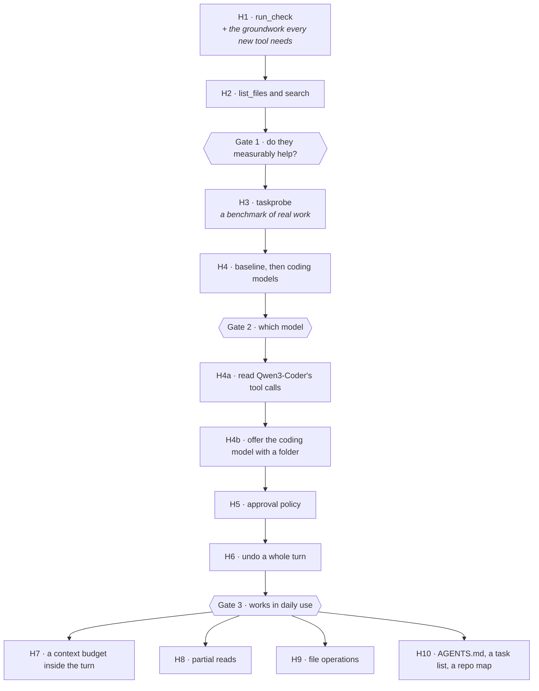

# Stage H — Execution Packet

**Paste this into a fresh chat.** Self-contained; it doesn't assume the earlier conversations.
**Where it stands:** [docs/H-status.md](../docs/H-status.md).

---

## Context

**Mímir** (`apps/mimir`) is the local chat app built in Stage G. Through G7 it learned to read,
edit and create files in one folder you pick, each call approved one at a time, and measured 98%
byte-exact on single edits ([G7-results.md](../docs/results/G7-results.md)). It has three tools,
ten rounds per answer and a 32k context on `qwen3-vl:8b-instruct-q4_K_M`.

**What it cannot do yet** is what makes a coding assistant trustworthy: it cannot find code by
itself, it never learns that an edit broke the build, and nobody has measured it writing code
rather than changing a line. Stage H closes those gaps in four phases, each ending in a
measurement that decides whether the next is worth building.

**Hard rule, unchanged:** everything runs locally. No cloud API calls, ever. If the model is not
good enough, the fix is a different local model, not a fallback.

---

## Three decisions already made — do not relitigate them mid-build

1. **Every new tool asks on every call**, exactly as `read_file` does, until H5 revisits the policy
   on evidence *(revisited at H5, 2026-10-02 — see H5)*. G6's reasoning still holds until then: every tool call is code the model chose to
   run, and every convenience works by removing the moment where you look.

2. **The check command is picked, not typed.** Rust detects candidates from the folder
   (`Cargo.toml` → `cargo check`, `package.json` → `npm test`) and the webview chooses one **by
   position**, the way recent folders already work. No command string ever crosses the IPC
   boundary, so nothing reaching it — a hostile page included — can choose what runs. A custom
   command goes in `config.json` by hand.

3. **One chunk at a time, with a gate between phases.** Each chunk is checked — tests, build,
   probe, end-to-end, an independent review — and written up before the next starts. At each gate
   the numbers decide, with a person, whether to go on.

---

## The order, and what gates what

**The order matters.** The benchmark needs Phase 1's tools to mean anything, and the approval
choice depends on what the benchmark shows. Phase 4's chunks can go in any order; each gets a
benchmark run with it on and off, and stays only if the pass rate holds.

---

## How every chunk is checked

- `cargo test -p odin-core` and `cargo test -p mimir` green; `cargo clippy -p odin-core -p bench`
- `npm run app:mimir` — **never** a bare `cargo build -p mimir` (README: it bakes in `devUrl`)
- the chunk's probe, and its end-to-end script against the built app with
  `WEBVIEW2_ADDITIONAL_BROWSER_ARGUMENTS=--remote-debugging-port=9223`
- an **independent review** of the diff against the chunk's guarantees, by someone who did not
  write it; fix what it finds and re-run the checks
- what needs a person goes into [PENDING-CHECKS.md](../docs/PENDING-CHECKS.md) and the
  [H-testing.md](../docs/H-testing.md) worksheet
- a write-up in `docs/results/H<n>-results.md`, in G7-results.md's shape
- its row in [H-status.md](../docs/H-status.md), the one-page chart of where Stage H stands

Probes use editprobe's scheme — **3 runs at the app's own sampling plus 1 at temperature 0** —
and a margin set **before** the run, so the numbers cannot move the bar.

---

## H1 — `run_check`, and the groundwork the new tools need

> **Built 2026-09-29, f95365f** — [H1-results.md](../docs/results/H1-results.md). Fix tasks 33% →
> 79% with the check.

**Do:**

*Groundwork, because every new tool hits it:*
- **Replay real arguments.** `toWire`, `persist` and `openConvo` rebuild every past call as
  `{path}`. A search would come back without its text, and the model copies what it sees. `Entry`
  gains `args`, saved and replayed.
- **Card states that fit a command.** `Ran` gains `ok` (success is no longer "does not start with
  `error:`"), and `Entry.state` gains `running`, so a long check does not keep offering
  Allow/Deny.
- **Stop after `run_tool`:** write the result into the card, *then* persist and return if the
  request was stopped. Returning first loses a written edit's undo handle.
- **One probe loop** shared by every probe (`crates/bench/src/probe.rs`, included by `#[path]`):
  a probe-only round bound, rounds recorded, an environment override (scratch `APPDATA`, a shared
  `CARGO_TARGET_DIR`, `CARGO_NET_OFFLINE=true`), and a Smart App Control block counted as ERROR,
  not FAIL.

*The check itself — `crates/odin-core/src/check.rs`:*
- `candidates(ws)`: `cargo check`, `cargo test`; `npm.cmd test` and `npm.cmd run build` only for
  scripts that exist (npm's default `"no test specified"` is not one). Each carries a timeout —
  180 s for a check, 600 s for tests.
- `run(root, argv, timeout, env, cancelled)`: runs in `root_display()` (cmd.exe refuses a
  `\\?\` working directory), `CREATE_NO_WINDOW` as in `ollama::spawn_detached`, stdout and stderr
  merged through one `std::io::pipe()` read on one thread, keeping only the first 6 KB, a rolling
  last 2 KB and a byte count. `CARGO_TERM_COLOR=never`, `NO_COLOR=1`,
  `NoDefaultCurrentDirectoryInExePath=1`. Polls `try_wait` against the timeout and `cancelled()`;
  everything the command starts runs in one Windows job object (kill-on-close), so Stop, a timeout,
  a check that leaves something running, and Mímir exiting all end the whole tree; `taskkill /T /F`
  backs it up. The reader has a deadline after exit,
  so a grandchild holding the pipe cannot hang the app.
- `for_model`: exit code, duration, capped output. **Never starts with `error:`** unless the
  command could not start, or repeat-detection reads a normal failing build as "stuck". Smart App
  Control's signatures become *"blocked by Smart App Control — not a code problem; don't edit;
  tell the user."*

*Wiring:*
- `Config.checks`, keyed by folder, looked up case-insensitively.
- A `run_check` tool with no arguments, offered only when the folder has one;
  `system_prompt(ws, check)` tells the model to run it after changing code.
- The approval ticket holds **root and argv**; `run_tool` runs what the ticket holds.
- Stop kills a running check: `run_tool` takes a stream id and passes `stopped(id)` down.
- `check_options`, `set_check(index)`, `clear_check`; the folder chip shows the check and a picker,
  disabled while an answer runs.

*Refusals, added here because a check makes them matter:*
- Files that change what a check executes are refused like `.git`: `.cargo/config(.toml)`,
  `rust-toolchain(.toml)`, `.npmrc`. A Run-check card says so when `build.rs`, `Cargo.toml` or
  `package.json` changed earlier in the turn.
- Mímir's own data folder (`%APPDATA%\odin`) is refused when it falls inside the project folder.

*Measured by:* `fixprobe` — an offline copy of editprobe's project (no `serde`, its own
`[workspace]`, a typed use of `PORT`), about eight tasks whose naive edit breaks the build, scored
on "`cargo check` passes **and** the change is there", with and without `run_check`. And
`tools/e2e/mimir-check.mjs`: a passing check, a failing one followed by a fix, a denial, and Stop
killing `cmd /c ping -n 60 127.0.0.1` with nothing left in `tasklist`.

**Done when:** fixprobe has numbers with and without the check, the end-to-end test passes, and the
review's findings are fixed.

**Watch for:** Smart App Control. A new dependency rebuilds proc-macro DLLs with fresh hashes, and
this machine has refused them before (`E0463`, Code Integrity event 3077). `cargo clean -p <crate>`
and rebuild — PLAN.md §3. And a console window flashing on screen means `CREATE_NO_WINDOW` is
missing somewhere.

---

## H2 — `list_files` and `search`

> **Built 2026-09-29, 6653c27** — [H2-results.md](../docs/results/H2-results.md). Named questions
> 0% → 88%; vague ones stay near 10%. Gate 1 passed 2026-09-30.

**Do:** `crates/odin-core/src/search.rs`, on the `ignore` crate for `.gitignore` rules and a
`globset` matcher over relative paths — **not** `ignore`'s overrides, because a matching override
beats `.gitignore` and `**/*` would walk straight into `target/`. Walk from the plain root with
`hidden(false)` and `require_git(false)`; always skip `.git`, `target`, `node_modules` and Mímir's
data folder; skip symlink entries; cap files, bytes and time, and honour Stop — choosing
`C:\Users\you` as the folder must stay stoppable.

`list_files(pattern?)` defaults to everything and reads a bare folder name as `dir/**`.
`search(text, pattern?)` is a **literal**, smart-case match — no regex for a small model to
malform. Output is `path:line: text`, sorted, capped at about **8 KB** with the full count.

`read_file` stops saying "only use this when the user refers to a file", and the system prompt
says "to find code, use list_files and search; don't guess paths". Re-run editprobe after the
wording change: tools.rs promises the probes measure the words the app ships.

*Measured by:* `findprobe` — a detached worktree of odin at a pinned commit, fifteen questions
(half exact, half vague, plus a few needing no tool), passing when the answer names the right file
**and** the fact. Variants: read only, with search, and later with a repo map (H10).

**Done when:** findprobe has numbers for read-only against search, and the checks pass.

**Watch for:** containment. `../**`, `C:/**` and `\\?\…` patterns must match nothing, and a
junctioned folder must not be followed — each with a test.

---

## Gate 1

Do `run_check` and search measurably help, against a margin set before the run? If not, fix the
tools or their wording before building a benchmark on top of them.

---

## H3 — `taskprobe`

> **Built 2026-09-30** — [H3-results.md](../docs/results/H3-results.md). As designed, plus: reads
> in the probe are confined to the worktree, and runs share the repo's own target folder rather
> than a fresh one.

**Do:** A benchmark of real work. Only 8 of the repo's commits add tests, so it mixes two kinds of
task:

- **Real commits**, cut to the files their tests cover — b38bc86 (`LoadedModel::pinned`), e3b43eb
  (odin-core's `tools.rs`), 871f297 (`store::attachment_path`), 27f6faf (`config.rs`).
- **About fourteen function removals** at a pinned HEAD — the body becomes `todo!()` and the
  function's own tests are hidden: `tidy_deletion`, CRLF/BOM handling, `Workspace` containment,
  `undo`, `render_chatml`, `extract_calls`, `repair`, `prior_failures`, `interpret`,
  `display_title`.

Each run: a detached worktree in `%TEMP%`; the target file cut at `#[cfg(test)]`; a written task
**with exact signatures** (one wrong name fails the whole test build); the shared probe loop with
every Phase 1 tool; then the reference tests put back and `cargo test -p odin-core --lib --
<module>::tests::`. The worktree is removed in a `finally`.

**Done when:** every task scores pass, fail or error, with rounds used under a probe-only bound
above ten.

**Watch for:** a fresh `CARGO_TARGET_DIR` rebuilds proc-macros — warm it once before the run.

---

## H4 — Baseline, then the model decision

> **Measured 2026-10-01** — [H4-results.md](../docs/results/H4-results.md). Bar set first: ≥10/48.
> Baseline 6/48 · Devstral Small 2 24/48 · **Qwen3-Coder 30B-A3B 25/48, 5× faster** · gpt-oss
> 11/48. All three cleared; none fits the card but gpt-oss; all are text-only. **Gate 2, decided
> 2026-10-01: Qwen3-Coder** — once a recovery path for its XML tool calls is built and measured.

**Do:** taskprobe on the current model for a baseline. For each coding candidate, first measure its
VRAM at 16k and 32k the way `config.rs`'s table was made, and run toolprobe. The recovery for
malformed tool calls is Qwen-only (`toolcall.rs`), so another family either gets its own or lives
with Ollama's error. Set the switching margin, then run.

**Done when:** `H4-results.md` holds the numbers and a decision.

---

## Gate 2

Choose the model — and whether choosing a folder should offer to load it, since Heimdall refuses,
cleanly, while a text-only model is loaded (G3).

> **Decided 2026-10-01: Qwen3-Coder 30B-A3B, its tool calls fixed first (H4a); and yes, choosing a
> folder offers it (H4b).** Two chunks the plan did not have, done before H5.

---

## H4a — Reading Qwen3-Coder's tool calls

> **Built 2026-10-02** — [H4a-results.md](../docs/results/H4a-results.md). Tool probe 10/10 through the app's path;
> the render matches Ollama's prompt token for token; benchmark 28/48 with **no errors**, against
> H4's 25/48 with 8.

**Do:** Qwen3-Coder writes its calls as XML-like tags (`<function=NAME><parameter=KEY>…`), which
the JSON recovery in `toolcall.rs` cannot read. In H4 Ollama's own parser lost 8 of its runs: it
ends a call at the first `</tool_call>` even inside a value, and passes a call that lacks its
opening tag through as text. A second recovery, `xmlcall.rs`: the prompt rendered exactly as
Ollama's Go renderer does, sent raw, and read by a parser anchored on the offered tool and argument
names. The model's layout is read from its `PARSER` line, not guessed from its family.

**Done when:** the render gives Ollama's exact prompt token count; toolprobe through the app's path
is 10/10; a full taskprobe has no tool-call errors and scores at least H4's 25/48.

**Watch for:** `qwen3-coder`'s family, `qwen3moe`, starts with "qwen", so a family check alone
would send it down the JSON path. The same native request answers differently with a cold and a
warm prompt cache, so compare token counts and calls, not prose.

---

## H4b — Offering the coding model with a folder

> **Built 2026-10-02** — [H4b-results.md](../docs/results/H4b-results.md). Choosing a folder offers
> Qwen3-Coder; clearing it offers the way back; e2e 14/14, and the H1/H2 and G7 e2e still pass.

**Do:** `Config.coding_model` (default `qwen3-coder:30b`) and `Config.model_before_coding`. Rust
decides whether an offer applies (`offer_for`) and recomputes it on accept, so the webview sends
only a direction, never a tag. Accepting writes the config first — Heimdall refuses for the whole
switch rather than reloading the vision model — then unloads the old model and loads the new one.
A manual pick ends the switch-back. The bar sits above the composer; "Not now" holds for the
session.

**Done when:** e2e shows the offer, declining it, switching for real (config and `/api/ps` agree),
the coder answering a tool question in the app, and the switch back.

**Watch for:** Ollama is not running after a reboot until something starts it, and a folder is
often chosen before the first question — the offer must start it.

---

## H5 — The approval policy

> **Built 2026-10-02** — [H5-results.md](../docs/results/H5-results.md). Option B: reads, listings and searches
> inside the folder run without asking — cards per coding task 3.9 → 2.5, finding code 0 —
> with gitignored, secret-named, linked, remote and broad-folder reads still asking, and
> `ask_every_call` to switch it off. Benchmark 29/48 after the wording change (28 before).
> *Review round 1 (2026-10-09):* "gitignored" now means what git means — `.git/info/exclude`, the
> `.gitignore` files above the folder up to the repository's root, case-insensitive on Windows (R-07);
> and a config.json that does not parse now fails toward asking and is kept as `config.json.bad` (R-02).

**Do:** Starts with a decision: keep every call asking (A), let in-folder reads and searches run
freely (B), or review a whole turn at its end (C). If B: in-folder `read_file`, `list_files` and
`search` run without asking and show as quiet cards; reads outside the folder, `run_check` and
every edit still ask. "In the folder" is decided by `resolve_existing`, not a string join.

**Done when:** an outside read still asks, an inside one does not, and a taskprobe-sized task takes
measurably fewer clicks.

**Watch for:** this reverses G6. Say so in the results doc, and update the header in `tools.rs`
that promises otherwise.

---

## H6 — Undo a whole turn

> **Built 2026-10-02** — [H6-results.md](../docs/results/H6-results.md). A turn with two or more edits ends in "N edits in
> this turn · Undo all", asked twice; every file's chain is checked before anything is written;
> the real model's two-file turn came back byte for byte. The line sits at
> the end of the turn rather than "on an answer", so a turn that was stopped or ended in an error
> has it too (your choice).

**Do:** `edit::undo_turn(ids)` over the undo handles the frontend already holds for a turn — no
turn id needed. Skip ones already undone; pre-check each file's whole chain (the file matches its
last edit, and each backup matches the edit before it); restore newest first; retire each file's
records as it is restored. It cannot be atomic across files, so a failed write reports exactly what
was restored and leaves the rest undoable one at a time. "Undo turn" appears on an answer that made
two or more edits.

**Done when:** tests cover two files, one file edited twice, create-then-edit, a file changed since,
and a partly undone turn — and end to end, a two-file turn comes back byte for byte.

---

## Gate 3

The policy works in daily use.

---

## H7 — A context budget inside the turn

> **Built 2026-10-02** — [H7-results.md](../docs/results/H7-results.md). Old results are set aside, oldest first, before Ollama
> has to cut — the newest read of each file last, not never as written above. At 8k the request
> survives (e2e 8/8); at 32k the benchmark stays under budget (26/48 off, 30/48 on, no cuts either
> way). Rounds stay at 10.

**Do:** Trimming runs once per send today; inside a turn nothing is counted — not the system
prompt, the tool schemas, the raw arguments or the results. Two 64 KB reads overflow 32k, and
Ollama truncates silently. A pure `tools::compact` used by the app **and** the probe loop replaces
old tool results with a one-line stub — content only, never the message, so every call stays
paired with its result — in a stable order, keeping the newest read of each file and always the
user's request, calibrated against the last `promptEvalCount`. It says what it dropped. Then raise
`MAX_ROUNDS` (tools.rs and App.tsx together) from the rounds the probes recorded.

## H8 — Partial reads

> **Built 2026-10-03** — [H8-results.md](../docs/results/H8-results.md). `read_file` takes `start_line`/`end_line`, the range in
> a header; a file over 64 KB answers with its line count. A 120 KB file edited at line 2102, byte for
> byte (e2e 18/18); taskprobe 29/48 with ranges, 28/48 without, at almost one more round a task.

**Do:** `read_file(path, start_line?, end_line?)`, the range in a header line and never as
line-number prefixes (a small model copies them into `old_text`). Over 64 KB, return the line
count. `repair()` only recovers strings, so accept numbers sent as strings.

## H9 — File operations

> **Built 2026-10-03** — [H9-results.md](../docs/results/H9-results.md). New folders, delete and move, each asked and undoable,
> nothing able to overwrite. opsprobe 15/15 with Undo all restoring every run byte for byte;
> taskprobe 28/48 with the tools, 30/48 without, and the model never misused them.

**Do:** `create_file` makes missing parent folders — canonicalise the deepest existing ancestor,
then contain; H1's refusals still hold. `delete_file` and `move_file` through plan, approve, undo;
undo removes the folders it created.

**Decided 2026-10-03, before building:**
- **Nothing overwrites.** Windows' ordinary rename replaces an existing destination, so moves,
  moving back on undo, creates and restoring a delete all go through one no-replace move
  (`MoveFileExW` without `REPLACE_EXISTING`); only edits keep the replacing atomic write.
- **New paths** walk to the deepest existing folder inside the root, refuse `..` in the rest, cap
  new folders at 8 levels, refuse names Windows mishandles (`CON`, a trailing dot or space) and
  keep every H1 refusal (`.git`, `.cargo`, streams, app data). Delete and move take files only;
  a link as the source, a read-only file, a case-only rename and a move across drives are
  refused; deletes are capped at 16 MiB (the bytes are backed up).
- **Records gain a kind** (Edit, Create, Delete, Move), the move's destination, and the folders
  apply *actually* made; undo removes only those, never recursively, and only if empty.
- **Undo all is generalised:** instead of H6's chain per path, it replays the turn's changes newest
  first against a snapshot of the real files — edits, creates, deletes and moves alike — and
  refuses the whole turn if anything does not line up. H6's tests must still pass.
- **The window routes cards by name**, never falling back to a read card (a delete that looked
  like a read would be approved as one). Undo all counts "changes", not "edits". A move onto
  `build.rs` is flagged like an edit of it.
- **Measured by** a new `opsprobe` (rename, delete, nested create, move, and a trap: "remove a
  function" must not delete the file; after every run, Undo all must restore the fixture byte for
  byte), taskprobe with the new tools on and off (bar: ≥ 26/48, no errors), findprobe, and a new
  `mimir-ops.mjs` e2e.

## H10 — Project instructions, a task list, a repo map

> **Built 2026-10-08** — [H10-results.md](../docs/results/H10-results.md). Project notes (off until turned on per folder) and a
> task list ship; the repo map was measured and left out — one vague question gained, three no-tool
> ones lost, unasked edits. The finish line: 2 of 3 real rename-and-test runs did the whole job,
> and Undo all restored every run byte for byte. **Stage H is complete.**
> *Review round 1 (2026-10-09, R-03):* every one of those runs had ended at the 10-round cap — the
> last check ran, its result never went back, and the model never said it was done. Now automatic
> in-folder reads, listings and searches cost no round (a ceiling of 30 requests still bounds a turn),
> and a turn that reaches a bound gets one closing request with no tools, so it ends in the model's
> own words. Acceptance since: **3 of 3, no cap banner**; taskprobe 28/48 + 1 late, inside the
> 25–32 spread.

**Do:** `AGENTS.md`, off until turned on per folder, capped at 4 KB, inside `tools::system_prompt`
so the probes measure it. An `update_plan(items)` tool — no side effects, so it does not ask —
shown as a checklist and re-sent each round. A repo map: paths plus each file's first comment line,
about 2k tokens, scored with findprobe's repo-map variant. Embeddings only if findprobe still misses
vague questions, as a separate `search_meaning` tool beside grep.

**Decided 2026-10-08, before building:**
- **Instructions: the first found of `AGENTS.md`, `CLAUDE.md`, `.github/copilot-instructions.md`,
  `.cursorrules`** (Luis's choice), at the folder root, never through a link, read fresh each turn,
  cut at 4 KB on a line. Off until turned on per folder with a chip naming the file. Appended
  after the whole system prompt — every probe sentence still matches — and framed as *the
  project's notes, not the user's instructions*, which never change what needs approval.
- **`update_plan(plan)` takes one string**, a step per line marked `[ ]`, `[~]` or `[x]` — a string
  survives every tool-call recovery, an array of objects does not. It touches nothing, so it never
  asks. Capped at 12 short steps, so H7 never sets it aside: it rides in the conversation every
  round as the model's own call, with no extra message. **Its rounds do not count toward the 10**
  (Luis), but the 7th update in a turn is refused. Shown as one checklist per turn, updated in
  place.
- **The repo map is measured before it ships:** findprobe with and without it, same build. **It
  goes into the app only if vague questions reach 18/21 and named stay 24/24** (Luis); otherwise it
  stays a probe variant and the results say why. Code files only, each with its first header
  comment, ~7,000 characters.
- **Stage H's own finish line is tested:** a new acceptance e2e renames across files, adds a
  function with a unit test, runs `cargo test`, and Undo all must restore the fixture — 3 runs on
  the real model.

---

## Done with Stage H when

You hand Mímir a small change to a real project — rename across files, add a function with a test —
and trust the result without re-reading every line, because it found the code itself, ran the
check, and fixed what the check said.

## Do not

- **Do not let a command string cross the IPC boundary.** Checks are chosen by position from what
  Rust detected; anything else goes in `config.json` by hand.
- **Do not auto-approve anything before H5.** The policy changes on evidence, in one place, once.
  *(revisited at H5, 2026-10-02 — see H5)*
- **Do not start Phase 2 before Gate 1.** A benchmark built on tools that do not help measures the
  wrong thing.
- **Do not build embeddings before the repo map has been measured.** Grep finds every call site;
  retrieval finds the nearest few, and one missed call site is a half-done rename.
- **Do not truncate a read silently.** Refuse, or say what was cut — half a file answered
  confidently is worse than being told it was too big.
- **Do not run `cargo build -p mimir`.** `npm run app:mimir`.
- **Do not add attribution lines to commits.**
