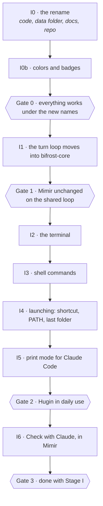

# Stage I — Execution Packet

**Paste this into a fresh chat.** Self-contained; it doesn't assume the earlier conversations.
**Where it stands:** `docs/I-status.md` (created in I0).

---

## Context

Stage H is complete and pushed (12/12 chunks, both review rounds fixed, hand checks 38/38 —
[H-status.md](../docs/H-status.md)). **Mímir** codes in a folder with Qwen3-Coder 30B-A3B: it
finds code, edits, runs the check, undoes a whole turn, and keeps a context budget.

Stage I does three things:

1. **Renames the project** to the names decided on 2026-10-03 — **Bifrost** for the suite,
   **Vidar** for the screen overlay (was Heimdall), **Mimir** for the workspace (no accent), and
   new colors and badges.
2. **Moves the turn loop into the shared crate**, so two apps can run the same engine.
3. **Builds Hugin**, the terminal app: our own Claude Code in the terminal, on that engine, and
   able to work with Claude Code in both directions.

Memory, skills, background jobs and the phone link are **later stages**, each behind its own gate.

**Hard rule, amended once on purpose (2026-10-12):** Bifrost runs locally and never calls the cloud
on its own. The single exception is I6's **Check with Claude** button in Mimir: off by default,
only on a click, and it says what it sends before it sends it. Claude Code calling `hugin -p` is
Claude's side reaching in; Hugin itself stays local.

---

## Decisions already made — do not relitigate them mid-build

1. **Names:** Bifrost · Vidar · Mimir · Hugin. **Everything** is renamed — command `bifrost`,
   crates `bifrost-core` / `bifrost-cli`, the GitHub repo `bifrost`. Text says **Mimir**, no accent.
2. **Colors** (dark-theme shade / light-theme shade), which still run in rainbow order like the
   bridge's three colors:
   - **Vidar · Wolf's Bane** `#e0525e` / `#a8273a`
   - **Mimir · Deep Well** `#5b9fe0` / `#1f5f9e` — replaces Sea as Mimir's default accent
   - **Hugin · Raven Violet** `#8b7cf8` / `#5a47d1`

   Red must never be the only sign of an error in Vidar: errors also carry words or an icon.
3. **Badges:** each app has its own, and Bifrost's mark is all three together.
4. **Hugin's behavior:**
   - It's a full agent, inline in the terminal like Claude Code, not a full-screen app.
   - The look is quiet: one header line, with color only on the prompt, approvals and results.
   - It starts in the folder it was opened in. The shortcut opens the **last folder used**.
   - **Approvals are like Mimir's.** In-folder reads and searches run on their own. Edits and
     commands ask `y/n`, and `a` allows that exact command for the rest of the session.
   - **`hugin -p` reads and proposes.** It never changes the user's folder: edits come back as a
     diff for Claude to apply.
5. **Mimir → Claude happens only on a button press**, never on Mimir's own initiative.
6. **One chunk at a time, with a gate between phases**, exactly as in Stage H. Commit each chunk
   locally once the user OKs it. Push only when the user says so. No attribution lines in commits.

---

## The order, and what gates what

**The order matters.** The rename goes first so nothing new is built under names that are about to
change. The loop moves before Hugin exists, so Hugin is never a second copy. I6 can't start until
Hugin works, because both depend on how the shared loop reports a turn.

---

## How every chunk is checked

- **Tests and lint:** `cargo test -p bifrost-core`, `-p mimir` and (from I2) `-p hugin` green;
  `cargo clippy -p bifrost-core -p bench -p hugin`.
- **Building the apps:** `npm run app:mimir` (and `app:vidar` when Vidar is touched), **never** a
  bare `cargo build` of an app.
  - The permission classifier may refuse to replace the exe the Desktop shortcut opens. Run the
    freshness check first: an exe newer than every source already matches HEAD. Otherwise ask the
    user to build it.
- **Probes and end-to-end:** the chunk's probe, and its end-to-end script against the built app.
  Probes use editprobe's scheme: **3 runs at the app's sampling plus 1 at temperature 0**, with a
  margin set **before** the run. Run taskprobe only when no other cargo is running, from a copied
  exe.
- **Review:** an **independent review** of the diff against the chunk's guarantees, by someone who
  didn't write it. Fix what it finds and re-run the checks.
- **Paperwork:**
  - Anything that needs a person goes into [PENDING-CHECKS.md](../docs/PENDING-CHECKS.md) and an
    `I-testing.md` worksheet.
  - A write-up in `docs/results/I<n>-results.md`, in H's shape.
  - The chunk's row in `docs/I-status.md`.

---

## I0 — The rename

**Do:**
- **Rust:**
  - Crates: `odin-core` → `bifrost-core`, `odin-cli` → `bifrost-cli` (binary `bifrost`),
    `heimdall`/`heimdall_lib` → `vidar`/`vidar_lib`. Every `odin_core::` path follows.
  - Folder: `apps/heimdall` → `apps/vidar`. Workspace members and `Cargo.lock` follow.
- **Tauri:**
  - Identifiers `com.odin.heimdall` → `com.bifrost.vidar`, and `com.odin.mimir` → `com.bifrost.mimir`.
  - Product names and window titles: **Vidar**, **Mimir**.
  - Events `heimdall://…` → `vidar://…`. Log prefixes and `%TEMP%\heimdall.log` → `vidar.log`.
- **Environment:** `HEIMDALL_*` → `VIDAR_*`; `HEIMDALL_NVML_PATH` → `BIFROST_NVML_PATH`.
- **npm:** the root package `odin` → `bifrost`; `@odin/ui` → `@bifrost/ui`. Scripts become
  `app:vidar` / `dev:vidar` / `app:mimir` / … and the bare `app` goes away.
- **The data folder:** `%APPDATA%\odin` → `%APPDATA%\bifrost`.
  - On first start, either app moves config, backups, conversations and attachments across,
    unless the new folder already exists.
  - Leave a `MOVED.txt` in the old folder.
  - Everything that names the folder follows: config.rs `path()`, `edit::backups_dir()`,
    store.rs, the "refuse our own data folder" rule, and the probes' scratch `APPDATA`.
- **Shortcuts:** `tools/shortcuts.mjs` writes `Vidar.lnk` and `Mimir.lnk` and removes
  `Heimdall.lnk` and `Mímir.lnk`.
- **Docs:**
  - Live docs (README, BUILD, PLAN's current sections, shortcuts.md, the testing worksheets)
    use the new names.
  - **History keeps its names**, as the 2026-09-26 rename did: `stages/`, `docs/results/` and
    `evals/out/` are not rewritten. A short note says so.
  - PLAN.md §0 records the hard-rule exception (see Context).
- **Last, and only with the user's go-ahead at that moment:**
  - Rename the GitHub repo to `bifrost` (`gh repo rename`). GitHub redirects the old URL.
  - Rename the local folder `…\repos\odin` → `…\repos\bifrost`. **Move Claude Code's project
    memory folder with it**: memory is keyed by path, so a plain folder rename orphans it.

*Measured by:*
- **Tests and builds:** every test suite and clippy; both apps built and started; every end-to-end
  script.
- **Shortcuts:** `node tools/shortcuts.mjs --check`.
- **Migration:** a run that starts from a populated `%APPDATA%\odin` and ends with the same
  conversations, backups and settings under `bifrost`.
- **Nothing missed:** a grep showing no `odin`/`heimdall` identifier left outside the history
  folders, other than the migration code that names the old folder on purpose.

**Done when:** all of that passes and the user has opened both apps under their new names.

**Watch for:**
- **WebView2 settings reset.** A new Tauri identifier gets a new WebView2 data folder, so
  localStorage starts empty: Mimir's accent and theme choices reset. Expected and harmless, because
  the default accent changes in I0b anyway, but tell the user.
- **Taskprobe's leftovers.** Its worktree temp names (`odin-taskprobe-*`) change; clean up any
  left behind under the old name.

---

## I0b — Colors and badges

**Do:**
- **Colors:**
  - Mimir's `DEFAULT_SEED` (accent.ts) becomes Deep Well, and the presets gain "Deep Well". Sea
    stays as a preset.
  - Vidar's accent becomes Wolf's Bane, with errors marked by words or an icon as well as color.
  - Hugin's Raven Violet goes into a shared colors file that the Rust side reads too.
- **Badges, design first:**
  - A board of options for three badges plus a Bifrost mark made of all three together. The user
    chooses before anything is drawn for real.
  - Then `tools/icon/badge.mjs`, `Badge.tsx`, the app icons and the tray icon.

*Measured by:*
- `npm run shots:mimir` in dark and light.
- Contrast of every accent shade against its background, 4.5:1 or better for text.
- The icons seen at 16, 32 and 256 px.

**Done when:** the user has picked the badges and both apps show the new colors and icons.

---

## Gate 0

Everything works under the new names: the user uses Vidar and Mimir for a day. Anything broken is
fixed before the loop moves.

---

## I1 — The turn loop moves into bifrost-core

**Today:** the loop is in Mimir's webview.
- It's an anonymous `useCallback` in `apps/mimir/src/App.tsx`, about lines 1140–1388, with
  `MAX_ROUNDS` and `MAX_FREE_CALLS` copied at App.tsx:146 and :152.
- Each round is one Rust command, `ask_with_tools` (`apps/mimir/src-tauri/src/lib.rs`, about
  805–1206).
- Approvals are a Promise in the webview, settled by the card buttons. Then `run_tool` redeems an
  armed ticket.
- The plain-Rust pieces also sit in lib.rs: tickets (≈663–711), `run_auto` (≈1241–1305) and
  `compact_for_send` (≈758–784).
- The probes in `crates/bench` have a loop of their own.

**Do, in two commits:**
1. **Move the plain pieces into `bifrost-core`, with no behavior change.** That's the tickets,
   `run_auto`/`run_read`/`run_find`, `compact_for_send` with its calibration, and the
   repeat-failure and plan-overflow checks.
2. **Write the loop in Rust:** `bifrost_core::agent::run_turn(convo, &config, frontend)`.
   - **`Frontend`** is a small trait: stream text, show a tool card, **ask for a decision**
     (`Allow` / `Deny` / `AllowForSession`), and report whether Stop was pressed.
   - **Everything the loop does today, moved over unchanged:**
     - the round rules (successful automatic calls give their round back, with a hard ceiling)
       and the closing no-tools request;
     - compaction with calibration carried across turns;
     - one call per reply (R-34 stays deferred);
     - persistence after each card;
     - H6's grouping of a turn's edits for Undo all.
   - **Mimir drives it** through one command with a `tauri::ipc::Channel` for events and a
     `decide(token, …)` command for approvals. App.tsx keeps only the rendering, and the copied
     constants are deleted.
   - **The probes run this same loop**, so they measure exactly what ships.

*Measured by:*
- Every Mimir end-to-end script, unchanged and green.
- taskprobe, fixprobe and findprobe within their Stage H spreads (taskprobe 27–29/48 at the last
  runs).
- A review that walks the old TypeScript loop line by line against the new Rust one.

**Done when:** the numbers hold and the review finds no behavior lost.

**Watch for:**
- **Stop at every point:** while streaming, while a card waits, and during a running check.
- **Approval tickets stay bound to the call they approved.** G6 and H5's guarantee: Mimir must still
  be unable to run anything that wasn't armed.

---

## Gate 1

Mimir works exactly as before on the shared loop: numbers within spread, and a day of real use.

---

## I2 — The terminal

**Do:** a new binary crate, `apps/hugin` (Rust, no Tauri).
- **The inline UI:**
  - Built on ratatui's inline viewport and crossterm. A one-day spike confirms it in Windows
    Terminal and VS Code's terminal; if it falls short, use plain crossterm.
  - Finished output goes into normal scrollback, and only the prompt box and status line are
    redrawn.
- **What you see:**
  - One header line: `hugin · <folder> · <branch> · <model>`.
  - The answer streams in, with tool lines like `● search "x" → 6 hits`.
  - Approvals are inline: `approve? [y/n/a]`.
  - Raven Violet on the prompt, approvals and results only. `NO_COLOR` is respected.
- **Keys:** Enter sends, Shift+Enter adds a new line, Esc or Ctrl+C stops the turn, and Ctrl+D or
  `/exit` leaves.
- **On start:**
  - The folder is where it was opened, or `--folder`.
  - It notes the git branch and the count of changed files.
  - Project notes load through `instructions.rs`.
  - The model is `Config.coding_model`, and Ollama is started and warmed through bifrost-core.
- **Sessions** are saved through `store.rs`, marked as Hugin's.

*Measured by:*
- Rendering snapshot tests (ratatui's test backend).
- A line mode when stdin isn't a terminal, so scripts can drive it: H's acceptance task run
  through Hugin, and Stop at each point.

**Done when:** you can do a real coding task in Hugin from start to finish in both terminals.

---

## I3 — Shell commands

**Do:**
- **The tool:** `run_command(command)`, in Hugin only. **Mimir keeps Stage H's picked checks**,
  because its webview reason still holds.
- **Approval:** every call asks `y/n/a`. The card shows the exact command, and `a` allows that
  exact string for the session.
- **The runner:** reuses check.rs's. That means the folder as working directory, a job object
  that kills the whole tree, capped output (first 6 KB, last 2 KB, a byte count), a timeout
  (default 120 s, configurable) and Stop.
- **Which shell,** PowerShell or cmd (or Git Bash if it's installed), is chosen by measurement, not
  guessed.

*Measured by:*
- `cmdprobe`: tasks whose answer needs a command (list, build, grep, git), scored per shell.
- End to end: allow, deny, session allow, Stop killing a long command, and nothing left in
  `tasklist`.

**Done when:** a shell is chosen on the numbers and the end-to-end test passes.

**Watch for:** destructive commands. The approval is the guard, so the card must show the command
exactly as it will run, with no shortening.

---

## I4 — Launching

**Do:**
- **On PATH:** an install step copies `hugin.exe` to `%LOCALAPPDATA%\bifrost\bin` and puts that on
  PATH, so `hugin` works in any terminal, VS Code's included.
- **`hugin --launch`:** reads `Config.hugin_last_folder` (updated on every start) and opens Windows
  Terminal there (`wt.exe -d <folder> hugin`), falling back to a plain console window.
- **The shortcut:** `tools/shortcuts.mjs` writes `Hugin.lnk` with the shortcut key
  **Ctrl+Alt+H**. A shortcut key on a Desktop or Start Menu `.lnk` needs no running process.

*Measured by:*
- The window watcher (EVENT_OBJECT_SHOW): pressing the key shows exactly one Windows Terminal
  window and nothing else.
- A launch end-to-end test from a different folder.

**Done when:** the key opens Hugin in the last folder, and `hugin` works from VS Code's terminal.

---

## I5 — Print mode for Claude Code

**Do:** `hugin -p "task" [--json]`.
- **It reads and proposes.** It works in a **scratch git worktree** of the folder: HEAD plus the
  current uncommitted changes, as taskprobe does. Full edit tools and the check run **there**,
  never in the user's folder.
- **Output:** the answer, a unified diff and the check result. `--json` returns the same as
  fields, for Claude Code.
- **Commands:** none except the check, because nobody is there to approve them.
- **Folders:** only git folders in version 1.
- **A note for Claude Code:** a short section that tells Claude when to hand work to Hugin, offered
  for the user's CLAUDE.md and never written there without an OK.

*Measured by:*
- taskprobe in propose mode (apply the diff, then check), compared with interactive mode.
- Several real tasks handed over from Claude Code.
- A rough comparison of Claude's tokens on one task, done with and without Hugin.

**Done when:** proposals apply cleanly and pass their check at close to the interactive rate.

---

## Gate 2

Hugin in daily use: the shortcut, approvals, commands and real tasks, plus Claude Code handing work
to Hugin. The user decides whether I6 is wanted now.

---

## I6 — Check with Claude, in Mimir

**Do:**
- **Settings:**
  - A **Claude checks** switch, **off by default**.
  - A status line saying whether the `claude` command is found and signed in.
  - An API key field **only if** `claude -p` can't work from the app. That's decided in this
    chunk, with the user.
- **The button:** **Check with Claude** on a finished turn that changed files.
  - It sends the user's question plus the turn's diff, built from the undo records.
  - Before sending it shows what will go: "Sends 2 files' changes (3 KB) to Claude".
- **The run:** `claude -p --output-format json` with the prompt on stdin, `CREATE_NO_WINDOW`, a
  timeout and Stop.
- **The answer** appears as a card clearly labeled **Claude**.
- **Never automatic.**

*Measured by:*
- End to end with a stand-in `claude` command for the wiring.
- One real run by the user (PENDING-CHECKS).

**Done when:** the check works on a click, nothing is sent without one, and the switch's default is
off.

---

## Done with Stage I when

- The suite is Bifrost, with Vidar, Mimir and Hugin under their names, colors and badges.
- Mimir runs on the shared loop with its numbers held.
- Hugin is used daily: the shortcut, approvals, commands, and Claude Code handing it work.
- Mimir can ask Claude to check a turn, on a click.

Then the next stage is planned: memory, skills, background jobs and the phone link, each a phase
with a gate.

## Do not

- **Don't call the cloud from Bifrost,** except I6's button, on a click.
- **Don't let `hugin -p` write to the user's folder,** or run anything but the check.
- **Don't run a shell command without a `y`** (or a session `a` for that exact command).
- **Don't give Mimir shell commands.**
- **Don't rewrite history docs** (`stages/`, `docs/results/`, `evals/out/`).
- **Don't rename the local folder without moving Claude Code's memory folder.**
- **Don't push or rename the GitHub repo** without the user's go-ahead at that moment.
- **Don't add attribution lines** to commits.
